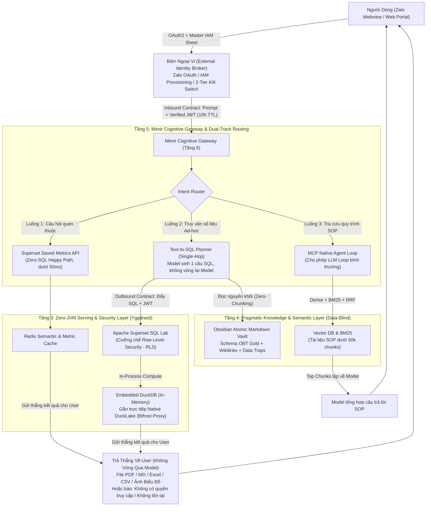
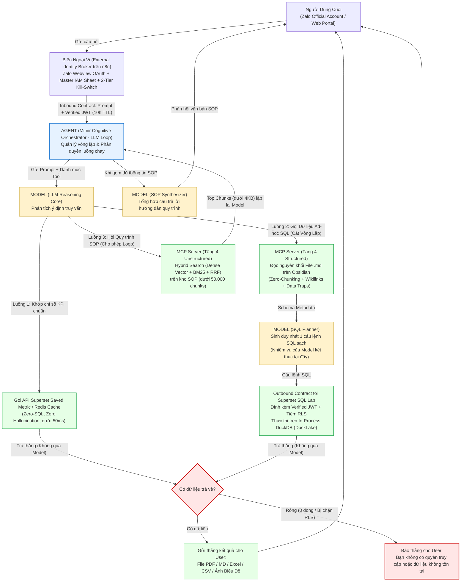

# Mimir — Pragmatic RAG & Cognitive Gateway

> **Tầng 4 (Knowledge & Semantic Layer) & Tầng 5 (AI Gateway & Orchestration Layer) — Hệ sinh thái Yggdrasil Data Platform**

---

## 1. Tổng Quan Kiến Trúc (Architecture Overview)

Trong hệ sinh thái **Yggdrasil Data Platform** (cùng với hai phân hệ hạ tầng anh em là **Valkyrie** — _Data Contract & Circuit Breaker Engine_ ở Tầng 2 và **Bifrost Proxy** — _Iceberg REST Catalog & DuckLake Sync Gateway_ ở Tầng 2/3), **Mimir** đảm nhiệm trọn vẹn hai tầng trí tuệ trên cùng:

- **Tầng 4 — Pragmatic Knowledge & Semantic Layer (Lớp Ngữ Nghĩa Data-Blind):**
  - **Tri thức Cấu trúc & Text-to-SQL (Schema OBT Gold, Từ điển nghiệp vụ, Data Traps):** Quản trị bằng **Obsidian Atomic Markdown Graph (`Zero-Chunking` + `[[Wikilinks]]`)**. Tuyệt đối không băm nhỏ (chunking) bảng biểu hay định nghĩa schema để bảo toàn 100% liên kết khóa ngoại và cảnh báo bẫy dữ liệu lịch sử.
  - **Tri thức Văn bản & Quy trình SOP (`< 50,000 chunks`):** Quản trị bằng **Vector Database kết hợp Hybrid Search (Dense Embedding + Sparse BM25 + Reciprocal Rank Fusion)** thay cho cỗ máy `Hyper-Scale Library` đắt đỏ.
- **Tầng 5 — Cognitive Gateway & Orchestration Layer (Cổng Nhận Thức & Điều Phối):**
  - Thực thi **Dual-Track Routing** (tách biệt luồng văn bản nhẹ với luồng dữ liệu nặng để bảo vệ bộ nhớ V8 Heap của Node.js/n8n), định tuyến 3 luồng truy vấn (**Flow 1: Saved Metrics `< 50ms`** / **Flow 2: Ad-hoc Text-to-SQL qua Superset RLS** / **Flow 3: SOP Hybrid Search**), và khóa cứng hành vi Agent bằng **Single-Hop Circuit Breaker**.

---

## 2. Ranh Giới Hệ Thống & Giao Ước Biên (System Boundaries & Edge Contracts)

Tầng 5 trong thiết kế tổng thể của Yggdrasil vốn chứa nhiều thành phần ngoại vi (như Zalo Webview OAuth, đồng bộ IAM từ Google Sheet của HR, hay kịch bản n8n tạo tài khoản tự động). Tuy nhiên, để giữ **Mimir Core** tinh gọn và không bị rác hóa bởi logic giao tiếp kênh chat, Mimir thiết lập ranh giới kiến trúc rõ ràng:

1. **Tách Biệt Tầng 4 & Tầng 5 Trong Cùng Một Repo:**
   - `Mimir` (Tầng 5) không thể hoạt động và không thể hiểu được nếu tách rời khỏi cấu trúc `Obsidian Atomic Markdown`, `Data Traps`, và `Hybrid Search` của Tầng 4. Do đó, repo này đóng gói trọn vẹn **Tầng 4 + Lõi Tầng 5 (Mimir Core)**.
2. **Giao Ước Biên Vào (Inbound Boundary Contract):**
   - Toàn bộ nghiệp vụ ngoại vi gồm **Zalo Webview OAuth**, **Google Sheet Master IAM Provisioning**, Rate-Limiting và **Cầu dao hủy khẩn cấp 2 cấp (Two-Tier Kill-Switch)** nằm ở lớp **External Channel & Identity Broker** phía trước Mimir. _(Lưu ý: Không nhầm lẫn lớp Identity Broker này với `Bifrost Proxy` — vốn là cổng Iceberg REST Catalog & DuckLake Sync ở Tầng 2/3, hay `Valkyrie` — bộ kiểm định Data Contract ở Tầng 2)_.
   - **Mimir Core** chỉ nhận đầu vào chuẩn hóa là **`Prompt + Verified JWT`** (JWT có thời hạn 10 tiếng do Superset/Identity Broker cấp, chứa claims định danh phòng ban/khu vực như `user_id`, `department`, `region`, `role`).
3. **Giao Ước Biên Ra (Outbound Boundary Contract via Superset RLS — Trả Thẳng Về User, Không Vòng Lại Model):**
   - **Data-Blind AI Tuyệt Đối Hai Chiều:** Mô hình LLM ở Tầng 4/5 mù tuyệt đối trước dữ liệu thô trong kho; Model chỉ đọc Metadata từ Obsidian để sinh câu lệnh SQL rồi kết thúc nhiệm vụ.
   - Câu lệnh SQL bắt buộc phải đẩy qua **Apache Superset SQL Lab** kèm theo JWT của người dùng. Superset tự động áp dụng **Row-Level Security (RLS)** (ví dụ: tự động tiêm `WHERE region = 'North'`) trước khi thực thi bằng **Embedded In-Process DuckDB (`duckdb:///:memory:`)** trên nền **Native DuckLake**.
   - **Xuất thẳng kết quả cho User (Zero Model Return-Trip):** Kết quả thực thi từ Superset/DuckDB **được gửi thẳng về cho người dùng cuối** dưới dạng file **`PDF`, `Markdown (.md)`, `Excel`, `CSV` hoặc `Ảnh biểu đồ (Chart Image)`** mà **không vòng ngược lại qua Model nữa**. Nếu kết quả rỗng (`0 dòng`), hệ thống trả thẳng thông báo: _"Bạn không có quyền truy cập hoặc dữ liệu không tồn tại"_. Nhờ đó, Model không bao giờ nhìn thấy số liệu thực tế và bộ nhớ V8 Heap của n8n được bảo vệ tuyệt đối.

---

## 3. Tuyên Ngôn Anti-LangChain: Bản Chất `Agent = LLM Loop` & Kiến Trúc Model – Agent – MCP

Trên thị trường hiện nay, khái niệm **"AI Agent"** thường bị thần thánh hóa để ép các đội kỹ thuật phải cài đặt những framework nặng nề như **LangChain** hay **LangGraph**. Thực chất, về mặt khoa học máy tính, cái mà người ta gọi là **Agent (hay ReAct Agent) chỉ đơn giản là một vòng lặp gọi Model (`LLM Loop`)**:

$$\text{Agent} = \text{Loop}\Big(\text{Model}(\text{Context}, \text{Tools}) \xrightarrow{\text{tool call}} \text{MCP Tool} \xrightarrow{\text{append result}} \text{Model}\Big)$$

- **Khi Model trả về `tool_calls`:** Bộ điều phối thực thi công cụ qua **MCP Server**, nối kết quả vào ngữ cảnh rồi **quay lại gọi Model (tiếp tục vòng lặp)**.
- **Khi Model chốt câu trả lời (`stop`):** **Thoát vòng lặp** và trả kết quả cho người dùng.

Việc LangChain bọc cái vòng lặp `if tool_call -> execute -> loop` đơn giản đó qua **15 tầng abstraction rò rỉ** không những biến việc debug thành ác mộng, mà còn tự ý nhét các đoạn hướng dẫn ngầm vào System Prompt (_Opaque Prompt Mutations_ làm tăng **Prompt Entropy** và gây **Attention Collapse**), đồng thời thả nổi vòng lặp gây cháy tiền token và tràn bộ nhớ **V8 Heap OOM** trên Node.js/n8n.

Thay vì dùng một bên thứ ba bọc chồng chéo ("wrapper của wrapper") như LangChain/LangGraph, **Mimir** triển khai trực tiếp qua kiến trúc **Model — Agent — MCP Server** (nếu dựng luồng low-code thì chạy trên **n8n State Machine**, còn nếu viết code Python thì dùng thẳng **bộ SDK chính hãng của các nhà làm Model: `claude-agent-sdk` của Anthropic, `openai-agents` của OpenAI, hoặc `google-genai` của Google** — vốn đã tích hợp sẵn `LLM Loop`, kết nối thẳng `MCP Server` và tham số giới hạn số vòng lặp chính chủ) với **chế độ kiểm soát vòng lặp phân biệt rõ theo từng luồng (Dual-Track Loop Control)**:

- **Luồng Hỏi Quy Trình / Văn Bản SOP (Track A — Luồng 3) $\implies$ Cho phép `LLM Loop` lặp bình thường (Multi-Hop):** Vì dữ liệu trả về từ công cụ tìm kiếm SOP (`Hybrid Search: Dense + BM25`) chỉ là vài đoạn văn bản ngắn (`< 4KB`), hoàn toàn không đe dọa bộ nhớ V8 Heap và không chứa số liệu nhạy cảm, Agent được phép lặp tự nhiên qua nhiều bước tra cứu để Model đối chiếu chéo các quy định trước khi chốt câu trả lời.
- **Luồng Gọi Dữ Liệu / Text-to-SQL (Track B — Luồng 2) $\implies$ Cắt sạch vòng lặp (`Single-Hop`) & Gửi thẳng kết quả cho User (Không vòng lại Model):** Riêng với truy vấn cơ sở dữ liệu, Model chỉ làm đúng 1 việc là đọc Schema Obsidian và sinh 1 câu lệnh SQL. Ngay sau khi câu lệnh SQL được đẩy qua **Superset RLS (In-Process DuckDB)**, **kết quả (`PDF`, `MD`, `Excel`, `CSV`, `Ảnh biểu đồ`) được bắn thẳng về cho người dùng cuối mà không quay ngược lại Model nữa** (nếu không có dữ liệu thì báo thẳng _"Bạn không có quyền truy cập hoặc dữ liệu không tồn tại"_). Cách này triệt tiêu 100% nguy cơ lộ dữ liệu thô cho LLM, cắt đứt vòng lặp tự sửa SQL và giải phóng hoàn toàn bộ nhớ điều phối!

### Sơ Đồ Luồng Điều Phối Tổng Thể Của Hệ Thống (Model – Agent – MCP Flow)

---

## 4. Ma Trận Lựa Chọn Kiến Trúc RAG Theo Quy Mô Dữ Liệu (Volume-Based RAG Selection Matrix)

Thay vì rơi vào cạm bẫy **Engineer's Hubris** (dùng đại bác bắn chim sẻ), Mimir phân định rõ kiến trúc RAG theo quy mô phân đoạn dữ liệu thực tế và chi phí vận hành trên mỗi **1 tỷ token (`1B tokens`)**:

| Quy mô Dữ liệu (Volume)                                    | Kiến trúc Khuyến nghị                                                                                             |           Chi phí (`$/1B tokens`)           |     Điểm MTEB Finance (`ndcg_at_10`)     | Yêu cầu Vận hành & Rủi ro                                                                                        | Phán quyết trong Mimir                 |
| :--------------------------------------------------------- | :---------------------------------------------------------------------------------------------------------------- | :-----------------------------------------: | :--------------------------------------: | :--------------------------------------------------------------------------------------------------------------- | :------------------------------------- |
| **SMB & Mid-Market (`< 50k chunks` SOP + `~50` bảng OBT)** | **Nhịp 2 — Pragmatic Hybrid:** Vector DB (`Dense + BM25`) cho SOP + **Obsidian `[[Wikilinks]]`** cho SQL Schema   | **`~$20`** _(API)_ hoặc **`~$0`** _(Local)_ | **`~87` điểm** _(100% tất định cho SQL)_ | Zero Ops, không sợ mù nhánh, triển khai trong 1–2 ngày                                                           | **CHỌN TRIỂN KHAI (Target Design)**    |
| **Bước đệm trung gian (Đã loại bỏ)**                       | **Nhịp 1 — Flat Summary Librarian:** Bỏ cây DNS & Dreaming; `Librarian` đọc toàn bộ tóm tắt phẳng + chấm xác suất |         `$40 – $80` _(Cắt 50–75%)_          |             `~90 – 92` điểm              | Vẫn đắt gấp nhiều lần Embedding; nghẽn ngữ cảnh khi danh sách tóm tắt phình to                                   | **BỎ QUA (Skipped)**                   |
| **Hyper-Scale Enterprise (`4M – 5M+ chunks`)**             | **Nấc 0 — Full Hyper-Scale Library:** `DNS Semantic Tree` (4 octets) + `Librarian` + `STM/LTM Dreaming`           |              **`$140 – $160`**              |            **`95 – 98` điểm**            | Đòi hỏi kỹ sư hiểu sâu **`Semantic Density & Diversity`** để chạy CLI `Merge-Split`; rủi ro **Subtree Blinding** | **Lưu Blueprint Dự phòng (`docs/04`)** |

---

## 5. Bản Đồ Điều Hướng Tài Liệu Kỹ Thuật (Architecture Documentation Map)

> [!TIP]
> **Muốn Triển Khai Ngay Mà Không Cần Đọc Lý Thuyết?**  
> Nếu bạn là Developer chỉ cần bắt tay vào dựng hệ thống cho doanh nghiệp quy mô `< 50,000 chunks` mà không muốn đau đầu với Lý thuyết Thông tin hay Toán học Vector, **hãy đọc duy nhất trang này rồi đi code ngay:**  
> 👉 **[docs/00_quickstart_without_theory.md](./docs/00_quickstart_without_theory.md) — Sổ Tay Triển Khai "Không Cần Hiểu Lý Thuyết" (4 Luật Cấm & 4 Bước Cắm Chạy)**.

1. **Từ Điển Thuật Ngữ Cốt Lõi (Ubiquitous Language):**
   - [GLOSSARY.md](./GLOSSARY.md) — Định nghĩa chuẩn hóa 20 khái niệm nghiệp vụ và kiến trúc bất biến của Mimir (Zero Implementation Details).
2. **Tầng 4: Vật Lý Ngữ Cảnh & Lớp Ngữ Nghĩa Data-Blind:**
   - [docs/01_context_physics_and_rag_failures.md](./docs/01_context_physics_and_rag_failures.md) — Vật lý Ngữ cảnh: Tại sao bỏ Chunking/Overlap, Prompt Entropy, Attention Collapse và Vector Density Collapse ở mốc 4–5 triệu chunks.
   - [docs/02_data_blind_semantic_layer.md](./docs/02_data_blind_semantic_layer.md) — Thiết kế Tầng 4 Thực chiến: Triết lý Data-Blind AI, Obsidian Atomic Markdown (`Zero-Chunking` + `[[Wikilinks]]` + `Data Traps`) cho SQL và Hybrid Search (`Dense + BM25`) cho SOP `< 50k chunks`.
3. **Tầng 5: Cổng Nhận Thức Mimir Core, Dual-Track & Cầu Dao Single-Hop:**
   - [docs/03_cognitive_gateway_and_dual_track.md](./docs/03_cognitive_gateway_and_dual_track.md) — Thiết kế Tầng 5 Mimir Core: Giao ước biên (`Prompt + Verified JWT` $\to$ Superset RLS trên DuckLake/DuckDB), Định tuyến Luồng Kép (Dual-Track), 3 Luồng truy vấn và Cầu dao Single-Hop.
   - [docs/adr/0002-protocol-first-mcp-and-single-hop-guard.md](./docs/adr/0002-protocol-first-mcp-and-single-hop-guard.md) — ADR 0002: Khai tử LangChain/LangGraph — Chuẩn hóa kiến trúc Model – Agent – MCP & Cầu dao Single-Hop.
4. **Blueprint Hyper-Scale Library (Proprietary R&D) & Báo Cáo Post-Mortem Thu Gọn Kiến Trúc:**
   - [docs/04_hyper_scale_library_blueprint.md](./docs/04_hyper_scale_library_blueprint.md) — Đặc tả cỗ máy Hyper-Scale Library MCP _(Bản R&D đã hiện thực hóa & đo kiểm nội bộ; giữ kín mã nguồn thực thi, chỉ công bố Blueprint)_: `DNS Semantic Tree` (`1..255`, mã kỹ thuật `0.0.0.0`, `0.1.0.0`, `n.0.1.0`, `*.dt.md`), `Split Domain`, CLI `Merge-Split Rebalancing` và chu trình `STM/LTM Dreaming`.
   - [docs/05_deescalation_and_fin_benchmarks.md](./docs/05_deescalation_and_fin_benchmarks.md) — Post-mortem thực nghiệm: Lộ trình thu gọn từ bản build `Library` nội bộ về Hybrid + Obsidian, Đối chuẩn 7 tác vụ MTEB Finance (`ndcg_at_10`) và Rào cản kỹ năng vận hành `Semantic Density & Diversity`.
   - [docs/adr/0001-deescalate-library-to-hybrid-and-obsidian.md](./docs/adr/0001-deescalate-library-to-hybrid-and-obsidian.md) — ADR 0001: Quyết định thu gọn từ Hyper-Scale Library (`$140–$160/1B tokens`) xuống Pragmatic Hybrid Vector + Obsidian (`~$20/1B tokens`).
