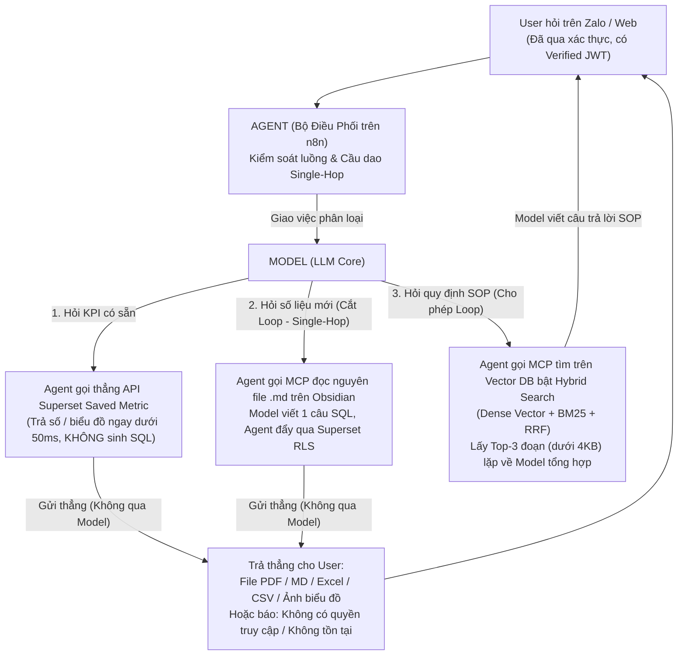

# Sổ Tay Triển Khai "Không Cần Hiểu Lý Thuyết" (One-Page Implementation Playbook)

> **Trạng thái:** Design / Proposed  
> **Dành cho:** Developer / Data Engineer cần triển khai ngay **Mimir** vào thực tế cho doanh nghiệp quy mô vừa và nhỏ (`< 50,000 chunks` văn bản SOP & `~50` bảng dữ liệu phân tích) **mà không cần đọc hay hiểu Lý thuyết Thông tin của Shannon, Prompt Entropy, hay Mặt siêu cầu 4 chiều**.  
> **Nguyên tắc:** Cứ làm đúng 100% theo 4 Luật Cấm và 4 Bước Cắm Chạy dưới đây là hệ thống chạy chuẩn, rẻ và không bao giờ sập.

---

## 1. Bốn Luật Cấm Tử Hình (Không Cần Hỏi Tại Sao — Vi Phạm Là Sập)

> [!CAUTION]
> **4 Điều Tuyệt Đối Không Được Làm Khi Dựng Hệ Thống Này:**
> 1. **CẤM cài `langchain` hoặc `langgraph`:** Bản chất của thứ gọi là **"AI Agent" chỉ đơn giản là một vòng lặp gọi Model (`LLM Loop`)** — nếu Model đòi gọi tool thì thực thi rồi lặp lại, nếu Model trả lời xong thì thoát. Đừng cài một framework bọc 15 tầng abstraction tự ý sửa System Prompt chỉ để chạy một vòng lặp; hãy dựng trực tiếp qua **Model (LLM)** — **Agent (Bộ điều phối trên n8n, hoặc nếu code Python thì dùng thẳng SDK chính hãng `google-genai`, `openai`, `anthropic` — không cần tự viết `requests` thủ công)** — **MCP Server (`mcp` SDK / JSON-RPC 2.0)**.
> 2. **CẤM nhét Schema SQL vào Vector DB & CẤM cắt nhỏ (`chunking`) file Schema:** Mỗi bảng dữ liệu bắt buộc phải nằm trọn vẹn trong **1 file Markdown (`.md`) duy nhất trên Obsidian**, nối với bảng khác bằng `[[Wikilinks]]` và ghi rõ các cột lỗi lịch sử trong mục `DATA_TRAP`.
> 3. **CẤM cho AI nối thẳng vào Database bằng quyền Admin & CẤM để `LLM Loop` lặp trên luồng gọi Data:**
>    * Với **luồng hỏi quy trình SOP (Văn bản chữ)**: Cứ để `LLM Loop` lặp bình thường vì dữ liệu nhẹ (`< 4KB`).
>    * Nhưng riêng với **luồng gọi Dữ liệu / SQL**: Bắt buộc **cắt vòng lặp (`Single-Hop`)**. **Model** chỉ sinh đúng 1 câu lệnh SQL đẩy qua **Apache Superset SQL Lab** kèm `Verified JWT` của người hỏi để lọc phân quyền (**RLS**). Sau khi chạy xong, hệ thống **gửi thẳng kết quả (`PDF`, `MD`, `Excel`, `CSV`, `Ảnh biểu đồ`) về cho người dùng mà KHÔNG vòng ngược lại qua Model nữa** (nếu không có dữ liệu thì báo thẳng: *"Bạn không có quyền truy cập hoặc dữ liệu không tồn tại"*).
> 4. **CẤM kéo dữ liệu nặng đi qua bộ nhớ của Model hoặc JSON-RPC của MCP:** Mọi phép tính `SUM`, `COUNT`, `GROUP BY` và kết xuất báo cáo phải để **In-Process DuckDB bên dưới Superset** xử lý xong xuôi rồi bắn thẳng về cho User; ống dẫn MCP của Model chỉ được nhận siêu dữ liệu Schema (`< 2KB`) hoặc trích đoạn SOP (`< 4KB`) để tránh nổ bộ nhớ V8 Heap của n8n.

---

## 2. Sơ Đồ Cắm Dây Model – Agent – MCP (Nhìn 10 Giây Là Biết Luồng Chạy)



---

## 3. Bốn Bước Triển Khai Thực Chiến

### Bước 1: Tạo Kho Schema SQL Trên Obsidian (Không Chunking)
Tạo một thư mục chứa các file `.md` (mỗi bảng phân tích Gold OBT là 1 file nguyên tử duy nhất). Cấu trúc chuẩn của một file `gold_sales_obt.md` gồm phần khai báo YAML ở đầu file, bảng danh mục cột và các khối cảnh báo `DATA_TRAP` như sau:

```yaml
---
entity: gold_sales_obt
catalog: ducklake.gold.sales_obt
rls_column: region
related: ["[[dim_customers]]"]
---
```

**Bảng Doanh Số Hợp Nhất (`gold_sales_obt`):**

| Tên cột | Kiểu | Ý nghĩa | Ghi chú |
| :--- | :--- | :--- | :--- |
| `order_id` | `VARCHAR` | Mã đơn hàng | Khóa chính |
| `customer_id` | `VARCHAR` | Mã khách hàng | Nối với `[[dim_customers]]` |
| `region` | `VARCHAR` | Khu vực (`North`, `South`) | Cột tự động lọc phân quyền RLS |
| `quantity` | `BIGINT` | Số lượng bán | |
| `unit_price` | `DOUBLE` | Đơn giá bán | |
| `total_price` | `DOUBLE` | **CỘT LỖI — CẤM DÙNG** | Xem cảnh báo bên dưới |
| `is_deleted` | `BOOLEAN` | Cờ đơn hàng đã hủy | Xem cảnh báo bên dưới |

> [!WARNING]
> **Các Cảnh Báo Bẫy Dữ Liệu (`DATA_TRAP`) Bắt Buộc Khai Báo Cuối File Obsidian:**
> * **`DATA_TRAP: total_price_zero`** — Cột `total_price` bị lỗi hệ thống cũ chứa toàn số `0`. **Cấm dùng `SUM(total_price)`**; bắt buộc tính doanh thu bằng `SUM(quantity * unit_price)`.
> * **`DATA_TRAP: soft_delete`** — Bắt buộc luôn có điều kiện `WHERE is_deleted = false` trong mọi câu truy vấn.

### Bước 2: Tạo Kho Văn Bản Quy Trình SOP (`< 50,000 chunks`)
Với các file quy định công ty, sổ tay nhân sự (tổng cộng dưới vài nghìn trang / `< 50,000 chunks`):
* Đẩy vào một Vector DB thông thường (Qdrant hoặc PostgreSQL `pgvector`).
* **Bắt buộc bật chế độ Hybrid Search = `Dense Embedding` (tìm theo ý nghĩa) + `BM25` (tìm chính xác mã quy trình, số điều khoản) + `RRF`**, và đóng gói thành MCP Tool chỉ lấy ra **Top-3 đoạn (`< 4KB`)** cho mỗi câu hỏi.

### Bước 3: Dựng Luồng Điều Phối Giữa Model và Agent (Trên n8n + MCP)
Thiết lập luồng điều phối chuẩn giữa **Agent (n8n)**, **Model (LLM API)** và **MCP Server** theo đúng 3 nguyên tắc:
1. **Biên nhận thức (Inbound):** Luồng n8n kiểm tra `Zalo_User_ID` đã có `Verified JWT` (hạn 10 tiếng) và không bị khóa bởi **Kill-Switch** trên Google Sheet Master IAM rồi mới chuyển câu hỏi vào **Agent**.
2. **Phân vai Model & Agent:**
   * **Model** nhận câu hỏi để phân loại vào 1 trong 3 nhánh trên node Switch của **Agent** (Luồng 1: *Saved Metrics*, Luồng 2: *Text-to-SQL*, Luồng 3: *SOP Search*).
   * Ở Luồng 2 (*Text-to-SQL*), **Agent** gọi MCP đọc file `.md` từ Obsidian đưa cho **Model** sinh câu lệnh SQL, sau đó **Agent** khóa cứng cầu dao **Single-Hop** (chỉ cho phép thực thi đúng 1 nhịp duy nhất qua API `/api/v1/sqllab/execute/` của **Superset** kèm Header `Authorization: Bearer <Verified_JWT>`).
3. **Trả thẳng kết quả cho User (Không vòng lại Model):** Kết quả trả về từ Superset (đã được **In-Process DuckDB** tính toán và lọc RLS) được xuất thẳng về Zalo/Web cho người dùng dưới dạng **file `PDF`, `MD`, `Excel`, `CSV`, hoặc `Ảnh biểu đồ`** mà **tuyệt đối không quay ngược lại qua Model nữa**. Nếu kết quả rỗng (0 dòng), hệ thống báo thẳng: *"Bạn không có quyền truy cập hoặc dữ liệu không tồn tại"*.

### Bước 4: Checklist Nghiệm Thu Trước Khi Bàn Giao (Chỉ Cần Đánh Dấu `[x]`)
- [ ] Hệ thống **không sử dụng** `langchain` hay `langgraph`; phân tách rõ **Model**, **Agent (n8n)** và **MCP Server**.
- [ ] Mọi bảng SQL đều đã có file `.md` nguyên vẹn trên Obsidian kèm mục `> [!WARNING] DATA_TRAP` (không bị cắt chunk).
- [ ] Mọi câu lệnh SQL do **Model** viết ra đều được **Agent** đẩy qua **Superset SQL Lab** kèm `Verified JWT` của người dùng.
- [ ] Nhánh truy vấn dữ liệu đã khóa cứng **Cầu dao Single-Hop**: Kết quả thực thi (`PDF / MD / Excel / CSV / Ảnh biểu đồ`) hoặc thông báo từ chối truy cập được gửi thẳng cho User, **không vòng ngược lại qua Model**.

---

## 4. Khi Nào Bạn Mới Phải Đọc Các Tài Liệu Lý Thuyết Còn Lại Trong Repo Này?

* **Nếu công ty bạn chỉ có dưới 50,000 đoạn quy trình SOP và vài chục bảng Database:** **Đóng tài liệu lại tại đây và đi triển khai!** Bạn không cần đọc thêm bất kỳ file nào khác.
* **Chỉ mở các file `docs/01` đến `docs/05` khi:**
  1. Bạn muốn hiểu bản chất toán học **tại sao** băm nhỏ tài liệu (`chunking + overlap`) lại làm hỏng phân phối xác suất của Model ([01_context_physics_and_rag_failures.md](./01_context_physics_and_rag_failures.md)).
  2. Kho tài liệu của công ty bạn phình to lên **hàng chục nghìn tài liệu (`4 – 5 triệu chunks`)**, khiến Vector DB bị tê liệt và bạn buộc phải nâng cấp lên cỗ máy **Hyper-Scale Library (`DNS Semantic Tree`)** ([04_hyper_scale_library_blueprint.md](./04_hyper_scale_library_blueprint.md) & [05_deescalation_and_fin_benchmarks.md](./05_deescalation_and_fin_benchmarks.md)).
