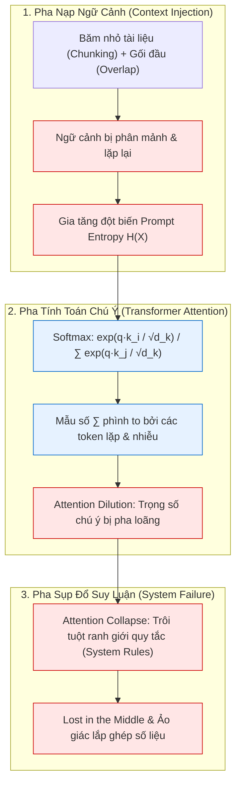
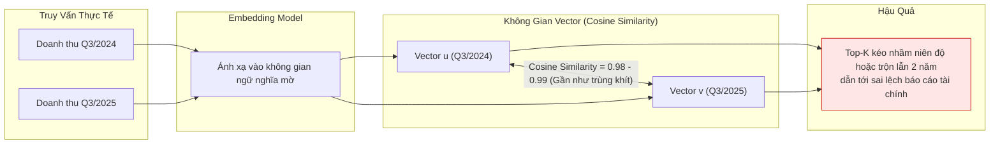

# Vật Lý Ngữ Cảnh và Tử Huyệt Của Naive Vector RAG

> **Tài liệu Kỹ thuật Tầng 4 (Knowledge & Semantic Layer) — Hệ sinh thái Yggdrasil Data Platform**  
> **Trạng thái:** Design / Proposed  

---

## 1. Hiện Tượng Vật Lý Ngữ Cảnh (Context Physics Fundamentals)

Trong các hệ thống phân tích dữ liệu doanh nghiệp ứng dụng mô hình ngôn ngữ lớn (LLM), vấn đề cốt lõi làm sụp đổ chất lượng suy luận **không nằm ở độ dài tuyệt đối của cửa sổ ngữ cảnh (Long Context Window 128k – 1M tokens)**, mà nằm ở **Prompt Entropy** — mức độ hỗn loạn, phân mảnh và nhiễu loạn thông tin bên trong một khối Prompt. Việc lầm tưởng rằng "cửa sổ ngữ cảnh càng rộng thì nhồi càng nhiều đoạn văn bản băm nhỏ (chunks) càng tốt" là nguyên nhân trực tiếp dẫn tới sự phá sản của các hệ thống Naive Vector RAG.

### 1.1 Bản Chất Lý Thuyết Thông Tin Của Prompt Entropy

Theo Lý thuyết Thông tin của Shannon, một văn bản nghiệp vụ nguyên vẹn không phải là tập hợp các token độc lập rời rạc (i.i.d.), mà là một chuỗi phụ thuộc có cấu trúc, nơi các mệnh đề liên kết chặt chẽ với nhau qua **Thông tin tương hỗ (Mutual Information $I(X_i ; X_j) > 0$)**. **Prompt Entropy** đo lường mức độ bất định cấu trúc và sự suy biến phân phối xác suất của toàn bộ khối ngữ cảnh $\mathcal{C}$ khi nạp vào mô hình:

$$H(\mathcal{C}) = - \sum_{i=1}^{n} P(x_i) \log_2 P(x_i), \quad H(Y \mid \mathcal{C}) = - \sum_{y \in \mathcal{Y}} P(y \mid \mathcal{C}) \log_2 P(y \mid \mathcal{C})$$

Khi mô hình ngôn ngữ giải mã tự hồi quy (Autoregressive Decoding), sự khác biệt giữa một khối ngữ cảnh nguyên tử và một khối ngữ cảnh bị băm nhỏ thể hiện trực tiếp qua hai trạng thái toán học:

* **Khối Ngữ Cảnh Nguyên Tử (Low-Entropy Atomic Context):** Khi $\mathcal{C}$ là một tài liệu nguyên khối giữ trọn vẹn mạch thông tin tương hỗ $I(X_i ; X_j)$ và không chứa đoạn lặp dư thừa, các trạng thái ẩn (Hidden States $h_t^{(l)}$) qua các tầng Transformer giữ được độ sắc nét đặc trưng cao. Phân phối hậu nghiệm $P(Y \mid \mathcal{C})$ hội tụ nhọn (Dirac-like distribution), buộc mô hình tuân thủ tuyệt đối các ràng buộc logic.
* **Khối Ngữ Cảnh Phân Mảnh & Ghép Nối Nhân Tạo (High-Entropy Fragmented Context):** Khi $\mathcal{C} = [C_1 \Vert C_2 \Vert \dots \Vert C_k]$ được ghép cơ học từ nhiều đoạn `chunks` rời rạc kèm các vùng lặp `overlap`, cơ chế Causal Self-Attention vẫn tính tích vô hướng $q_t \cdot k_\tau$ xuyên qua ranh giới nhân tạo giữa các chunk như thể chúng là một văn bản liên tục. Sự đứt gãy đột ngột của $I(C_a ; C_b)$ tại biên làm tăng vọt độ phân kỳ Kullback-Leibler ($D_{\text{KL}}$) so với phân phối ngôn ngữ tự nhiên, đẩy các trạng thái ẩn về trạng thái suy biến (Isotropic Collapse) và san phẳng phân phối xác suất đầu ra — khiến ngay cả khi khóa cứng `temperature = 0` (`argmax`), mô hình vẫn dễ dàng nhảy sang phương án ảo giác.

### 1.2 Cơ Chế Attention Dilution & Attention Collapse

Trái tim của kiến trúc Transformer là cơ chế tự chú ý (Self-Attention), trong đó trọng số chú ý $\alpha_i$ giữa vector truy vấn $q$ và vector khóa $k_i$ trên tổng số $N$ token trong ngữ cảnh được tính bằng hàm Softmax:

$$\alpha_i = \frac{\exp\left(\frac{q \cdot k_i}{\sqrt{d_k}}\right)}{\sum_{j=1}^{N} \exp\left(\frac{q \cdot k_j}{\sqrt{d_k}}\right)}$$

1. **Attention Dilution (Pha loãng sự chú ý):** Do tổng trọng số luôn bằng $1$ ($\sum_{i=1}^N \alpha_i = 1$), khi ta nhồi các đoạn văn bản bị cắt vụn và các đoạn lặp `overlap` vào Prompt, mẫu số $\sum_{j=1}^N \exp(q \cdot k_j / \sqrt{d_k})$ phình to bởi các token bán liên quan có tích vô hướng $q \cdot k_j$ xấp xỉ nhau. Biên độ chú ý dành cho các ràng buộc quan trọng (như cảnh báo bẫy dữ liệu hay điều kiện loại trừ) bị san phẳng về $\frac{1}{N}$.
2. **Attention Collapse (Sụp đổ sự chú ý):** Khi **Prompt Entropy** vượt ngưỡng chịu đựng, dù tổng số token mới chỉ chiếm một phần nhỏ của Context Window (ví dụ 8k–16k trên 128k tokens), cơ chế Attention bị sụp đổ hoàn toàn. Mô hình bắt đầu phớt lờ các chỉ thị trong System Prompt, quên mất điều kiện lọc ở giữa văn bản (**Lost in the Middle**), và tự bịa ra câu trả lời dựa trên thiên kiến tiền huấn luyện.

---

## 2. Tại Sao Phải Bãi Bỏ Chunking & Overlap (Zero-Chunking Philosophy)

Kỹ thuật kinh điển của Naive RAG — băm nhỏ tài liệu thành từng khúc cố định (`500–1000 tokens`) kèm khoảng gối đầu (`overlap 10–20%`) — thực chất là một giải pháp chữa cháy thô bạo cho giới hạn cửa sổ ngữ cảnh của thế hệ mô hình cũ, nhưng lại gây ra hai hậu quả chí mạng đối với dữ liệu doanh nghiệp và tài chính:

### 2.1 Nghịch Lý Shannon Của `Overlap` & Đứt Gãy Thông Tin Tương Hỗ

* **Nghịch lý của `Overlap` ($H(X_{\text{overlap}} \mid X_{\text{seen}}) = 0$ nhưng Trọng số Attention bị nhân đôi):** Theo định lý mã hóa nguồn của Shannon, khi hai chunk liên tiếp cùng lọt vào Top-K, phần văn bản gối đầu (`overlap`) bị lặp lại lần thứ hai có **Entropy có điều kiện bằng $0$** — tức là nó **không cung cấp thêm bất kỳ một bit thông tin mới nào** cho bài toán. Thế nhưng, mẫu số của hàm $\text{softmax}\left(\frac{QK^T}{\sqrt{d_k}}\right)$ không có cơ chế khử trùng lặp (de-duplication): các token nằm trong vùng `overlap` xuất hiện 2 lần sẽ hút **gấp đôi khối lượng xác suất (Probability Mass)** một cách vô căn cứ, làm lệch hoàn toàn ma trận phân bổ sự chú ý của khối Prompt.
* **Triệt tiêu Thông tin tương hỗ ($I(X_{\text{condition}} ; X_{\text{effect}}) \to 0$):** Một quy định nghiệp vụ hay một định nghĩa bảng dữ liệu là một chỉnh thể nguyên tử. Khi cắt đôi văn bản ở mốc token cố định, mệnh đề điều kiện (`NẾU...`) nằm ở Chunk 1 còn mệnh đề hệ quả (`THÌ...`) rơi sang Chunk 2. Khi bộ truy xuất chỉ kéo về Chunk 2, mối liên hệ phụ thuộc có điều kiện bị xóa sổ, buộc mô hình áp dụng quy tắc một cách mù quáng cho mọi trường hợp.

### 2.2 Thảm Họa Khi Cắt Vụn Báo Cáo Tài Chính & Schema Dữ Liệu

Trong báo cáo tài chính (P&L, Balance Sheet) và lược đồ cơ sở dữ liệu (Database Schema):
* Một con số kế toán tại dòng *"Chi phí dự phòng"* hoặc một cột `total_price` trong bảng đơn hàng **hoàn toàn vô nghĩa hoặc gây hiểu sai nghiêm trọng** nếu bị tách rời khỏi phần ghi chú chân trang (Footnote) hoặc khối cảnh báo **Data Trap** nằm cách đó vài chục dòng.
* Khi Top-K Retrieval ghép 5 đoạn chunk rời rạc từ các trang khác nhau vào chung một Prompt, LLM sẽ tự động "nội suy" để nối các mảnh vụn không liên quan thành một kết luận nghe có vẻ hợp lý — hiện tượng **Ảo giác lắp ghép (RAG Assembly Hallucination)**.

---

## 3. Ảo Giác Số Liệu & Xung Đột Thời Gian (Temporal & Numerical Blindness)

Vector Database hoàn toàn mù trước tính chất thứ tự của thời gian và độ lớn tuyệt đối của con số.

Phép đo tương đồng Cosine giữa hai vector $u$ và $v$:

$$\text{Cosine}(u, v) = \frac{u \cdot v}{\|u\|_2 \|v\|_2} = \cos(\theta)$$

chỉ đo **độ tương đồng chủ đề mờ (Fuzzy Semantic Similarity)**. Hai chuỗi văn bản `"Báo cáo tổng doanh thu thuần Quý 3 năm 2024"` và `"Báo cáo tổng doanh thu thuần Quý 3 năm 2025"` có điểm tương đồng Cosine đạt tới **98% – 99%**. Tương tự, các con số `10 triệu VND` và `10 tỷ VND` có vector nhúng gần như trùng nhau. Do đó, dùng Vector RAG để truy xuất số liệu kế toán hoặc lịch sử giao dịch là một sai lầm về mặt bản chất toán học.

---

## 4. Sụp Đổ Mật Độ Vector Ở Quy Mô Lớn (Vector Density Collapse)

Ngay cả đối với dữ liệu văn bản phi cấu trúc, Vector Database vẫn tồn tại một giới hạn vật lý khi quy mô dữ liệu phình to lên cấp độ định lượng toàn cầu (**4 – 5 triệu chunks**):

```mermaid
flowchart TD
    subgraph ScaleSMB["Quy Mô SMB (< 50,000 Chunks SOP)"]
        SA1["Không gian 1,536 chiều thưa thớt (Sparse Manifold)"]
        SA2["Biên độ phân tách rõ nét (Δ Cosine ~ 0.15 - 0.25)"]
        SA3["Hybrid Search (Dense + BM25) hoạt động chuẩn xác"]
        SA1 --> SA2 --> SA3
    end

    subgraph ScaleHyper["Quy Mô Hyper-Scale (4 - 5 Triệu Chunks)"]
        SB1["Không gian bị nén quá dày đặc (High Semantic Density)"]
        SB2["Hàng ngàn chunks chồng lấn trên cùng một vùng Manifold"]
        SB3["Điểm số bão hòa: 0.898 vs 0.899 (Δ = 0.001 < Noise Floor)"]
        SB4["Vector Density Collapse: Sương mù ngữ nghĩa, Top-K trả về ngẫu nhiên"]
        SB1 --> SB2 --> SB3 --> SB4
    end

    classDef pass fill:#e6ffe6,stroke:#009900,stroke-width:1px;
    classDef fail fill:#ffe6e6,stroke:#cc0000,stroke-width:1px;
    class SA3 pass;
    class SB4 fail;
```

* Ở quy mô **dưới 50,000 chunks** (khoảng 500 cuốn sổ tay quy trình SOP doanh nghiệp), không gian 1,536 chiều còn rất thưa; khoảng cách giữa tài liệu đúng và tài liệu nhiễu phân tách rõ ràng.
* Nhưng khi chạm ngưỡng **4 – 5 triệu chunks**, mật độ vector trong cùng một miền chuyên môn (như tài chính - ngân hàng) bị nén đặc tới mức hàng ngàn đoạn văn bản khác nhau đều có điểm Cosine Similarity xoay quanh `0.898` và `0.899`. Độ chênh lệch `0.001` nằm dưới ngưỡng nhiễu số học (Noise Floor), biến không gian tìm kiếm thành một vùng **Sương mù ngữ nghĩa (Semantic Fog)** khiến thuật toán HNSW/Top-K mất hoàn toàn khả năng phân loại.

---

## 5. Bế Tắc Vận Hành Hộp Đen & Lời Giải Thực Dụng Của Mimir

Khi một hệ thống Naive Vector RAG trả lời sai, kỹ sư rơi vào **ma trận 5 biến số hộp đen liên đới**: `Chunker` $\times$ `Embedding Model` $\times$ `Top-K` $\times$ `Vector Index` $\times$ `Reranker`. Không ai biết lỗi nằm ở khâu cắt chữ hay khâu nhúng vector, và mỗi lần sửa cấu hình là một lần phải xóa đi nhúng lại (re-embed) toàn bộ kho dữ liệu.

Để chấm dứt tình trạng này, **Mimir** thiết lập 3 nguyên tắc vật lý cốt lõi tại Tầng 4 (được trình bày chi tiết tại [02_data_blind_semantic_layer.md](./02_data_blind_semantic_layer.md)):
1. **Bãi bỏ hoàn toàn Chunking & Overlap đối với tri thức cấu trúc:** Mỗi thực thể nghiệp vụ hoặc bảng phân tích là một file **Obsidian Atomic Markdown** nguyên vẹn (`Zero-Chunking`) gắn kết bằng `[[Wikilinks]]`, giữ **Prompt Entropy** ở mức tối thiểu.
2. **Data-Blind AI cho số liệu:** Cấm tuyệt đối dùng Vector Search để tìm con số. Mọi truy vấn số liệu phải chuyển hóa thành câu lệnh SQL tất định chạy trên **Superset SQL Lab + In-Process DuckDB (`DuckLake`)**.
3. **Khu biệt hóa Hybrid Vector Search theo đúng quy mô:** Với tài liệu văn bản SOP quy mô doanh nghiệp (`< 50,000 chunks` — nơi chưa xảy ra *Vector Density Collapse*), sử dụng **Hybrid Search (Dense Vector + Sparse BM25 + RRF)** để đạt hiệu quả kinh tế tối đa; đồng thời đóng gói cỗ máy **Hyper-Scale Library (`DNS Semantic Tree`)** làm Blueprint dự phòng cho quy mô hàng triệu chunks ([04_hyper_scale_library_blueprint.md](./04_hyper_scale_library_blueprint.md)).
