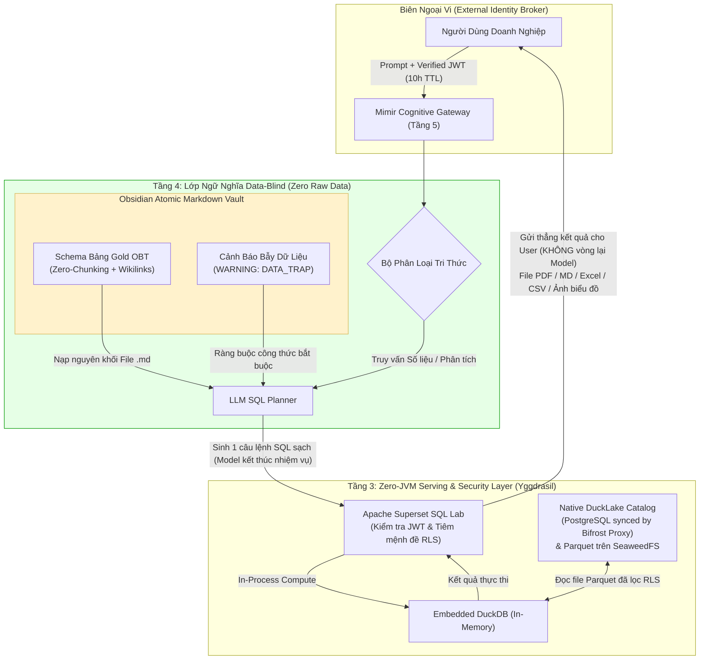
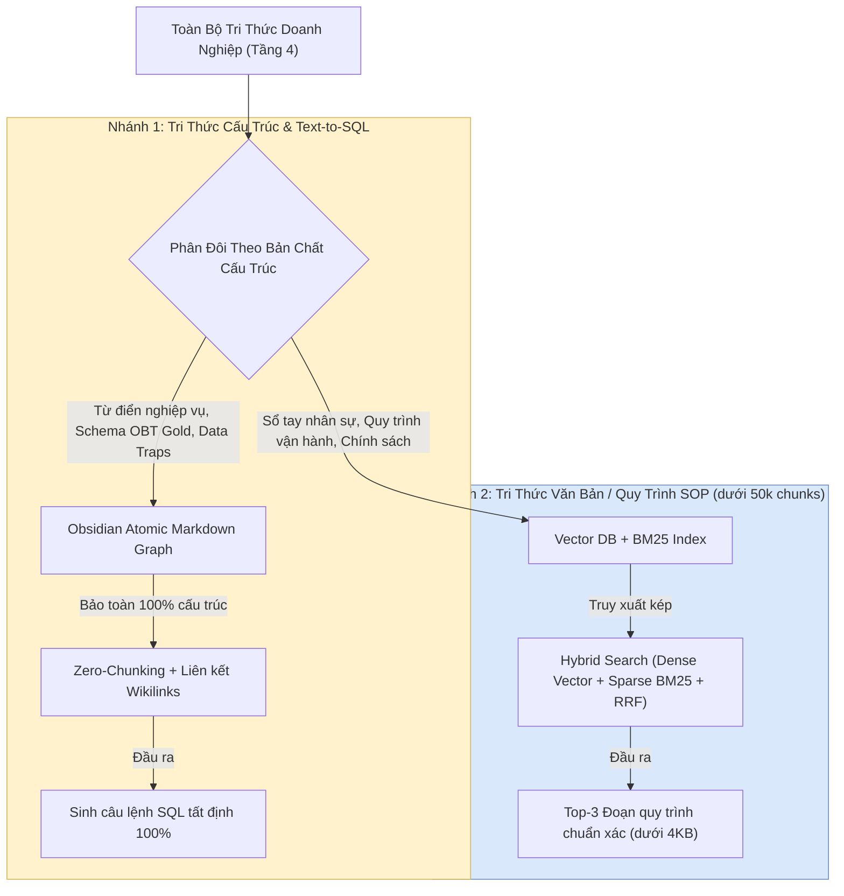
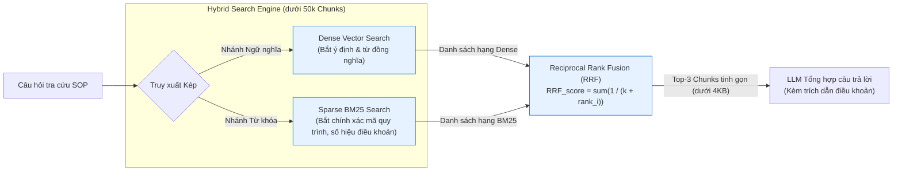

# Tầng 4 Thực Chiến: Lớp Ngữ Nghĩa Data-Blind và Phân Đôi Tri Thức

> **Tài liệu Kỹ thuật Tầng 4 (Knowledge & Semantic Layer) — Hệ sinh thái Yggdrasil Data Platform**  
> **Trạng thái:** Design / Proposed  

---

## 1. Triết Lý Data-Blind AI (The Data-Blind AI Principle)

Trong kiến trúc **Yggdrasil Data Platform**, ranh giới an toàn thông tin và tính chính xác toán học của **Mimir** được xây dựng trên nguyên tắc bất di bất dịch: **Data-Blind AI (AI Mù Dữ Liệu Thô)**.



### 1.1 Ba Nguyên Tắc Cô Lập Tuyệt Đối

1. **AI là Người Lập Kế Hoạch (Query Planner), Không Phải Người Đọc Dữ Liệu (Data Reader):** Mô hình LLM tuyệt đối không có quyền kết nối trực tiếp vào cơ sở dữ liệu vật lý và không bao giờ nhìn thấy các dòng dữ liệu giao dịch thô. LLM chỉ đọc **Metadata** (tên bảng, tên cột, kiểu dữ liệu, ý nghĩa nghiệp vụ, mối quan hệ khóa ngoại và bẫy dữ liệu) để viết câu lệnh SQL.
2. **Thực Thi Zero-JVM Qua Superset & Embedded DuckDB (`DuckLake`):** Tuân thủ tuyên ngôn **Zero-JVM** của Yggdrasil (đã khai tử hoàn toàn Apache Spark và Trino), câu lệnh SQL do Mimir sinh ra được đẩy qua **Apache Superset SQL Lab** kèm theo JWT của người dùng. Superset tự động tiêm mệnh đề phân quyền dòng (**Row-Level Security - RLS**) và thực thi trực tiếp bằng **In-Process DuckDB (`duckdb:///:memory:`)** gắn vào **Native DuckLake Catalog** (PostgreSQL được đồng bộ bởi `Bifrost Proxy`).
3. **Trả Thẳng Kết Quả Cho Người Dùng — Không Vòng Ngược Lại Qua Model:** Ngay sau khi Superset & DuckDB thực thi xong, kết quả được xuất thẳng về cho người dùng cuối dưới dạng **file `PDF`, `Markdown (.md)`, `Excel`, `CSV`, hoặc `Ảnh biểu đồ (Chart Image)`** mà **tuyệt đối không quay ngược lại qua Model nữa**. Nếu kết quả rỗng (do bị bộ lọc RLS chặn hoặc không có bản ghi khớp điều kiện), hệ thống trả thẳng thông báo: ***"Bạn không có quyền truy cập hoặc dữ liệu không tồn tại"***. Nhờ cơ chế này, Model mù dữ liệu thô 100% ở cả hai chiều (Bidirectional Data-Blindness).

---

## 2. Phân Đôi Tri Thức Tầng 4 (Bifurcation of Knowledge)

Sai lầm lớn nhất của các hệ thống RAG truyền thống là cố nhét cả quy trình văn bản lẫn lược đồ cơ sở dữ liệu vào chung một Vector Database. Mimir thực hiện **phân đôi triệt để Tầng 4** thành hai đường ray lưu trữ dựa trên bản chất vật lý của tri thức:



| Tiêu Chí Đối Chiếu | Nhánh 1: Tri Thức Cấu Trúc (Phục vụ Text-to-SQL) | Nhánh 2: Tri Thức Văn Bản / Quy Trình SOP (`< 50k chunks`) |
| :--- | :--- | :--- |
| **Đối tượng lưu trữ** | Từ điển nghiệp vụ, Schema các bảng Gold OBT, mối quan hệ khóa ngoại, cảnh báo bẫy dữ liệu (**Data Traps**). | Quy trình tác nghiệp chuẩn (SOP), quy định nhân sự, cẩm nang vận hành nội bộ. |
| **Nền tảng lưu trữ** | **Obsidian Atomic Markdown Vault** (Các file `.md` quản lý bằng Git). | **Vector Database + BM25** (Qdrant / pgvector). |
| **Chính sách Chunking** | **Zero-Chunking (Cấm băm nhỏ tuyệt đối)**. Mỗi bảng/thực thể là 1 file `.md` nguyên tử duy nhất. | Chia theo tiết mục logic của văn bản quy trình (Tổng quy mô doanh nghiệp `< 50,000 chunks`). |
| **Cơ chế định tuyến** | Duyệt liên kết hai chiều `[[Wikilinks]]` và YAML Frontmatter. | **Hybrid Search:** Dense Vector (ngữ nghĩa) + BM25 (từ khóa/mã hiệu) + RRF. |
| **Tại sao chọn giải pháp này?** | Băm nhỏ Schema sẽ làm đứt gãy khóa ngoại và làm rơi mất các dòng cảnh báo `Data Traps`, khiến LLM viết SQL sai số liệu. | Dưới `50k chunks`, không gian vector còn thưa (chưa bị *Vector Density Collapse*), dùng Hybrid Search rẻ và hiệu quả hơn `Library` gấp nhiều lần. |

---

## 3. Thiết Kế Obsidian Atomic Markdown Graph Cho Text-to-SQL

Thay vì dựng các cụm Graph Database cồng kềnh (như Neo4j đòi hỏi ngôn ngữ Cypher phức tạp), Mimir sử dụng **Obsidian Markdown Vault** kết hợp **Git** để quản trị đồ thị ngữ nghĩa của Kho dữ liệu.

### 3.1 Tinh Thần Zero-Chunking & Liên Kết `[[Wikilinks]]`

1. **Một Thực Thể = Một File Markdown Nguyên Tử:** Mỗi bảng phân tích **One Big Table (OBT)** tại tầng Gold (được tạo bởi `dbt-duckdb` ở Tầng 2) hoặc mỗi khái niệm nghiệp vụ được định nghĩa trọn vẹn trong một file `.md` duy nhất (dung lượng khoảng `300 – 800 tokens`).
2. **Bảo Toàn Mạng Lưới Liên Kết Bằng `[[Wikilinks]]`:**
   * Khi bảng `[[gold_sales_obt]]` có trường liên kết tới chiều khách hàng `[[dim_customers]]` hoặc quy tắc tính doanh thu `[[rule_net_revenue]]`, các file được nối trực tiếp bằng cú pháp `[[Wikilinks]]`.
   * Khi Agent cần viết SQL, nó đọc trọn vẹn file nguyên tử của bảng đó cùng các file liên kết trực tiếp, giữ cho **Prompt Entropy** ở mức thấp nhất và không bao giờ bị mất ngữ cảnh.

### 3.2 Cấu Trúc Mẫu File Thực Thể Trên Obsidian (`gold_sales_obt.md`)

Một file thực thể `.md` chuẩn trong Obsidian Vault gồm phần khai báo YAML Frontmatter ở đầu file, bảng danh mục cột kèm `[[Wikilinks]]` và khối cảnh báo `DATA_TRAP` ở cuối file:

```yaml
---
entity: gold_sales_obt
layer: gold_obt
catalog: ducklake.gold.sales_obt
owner: data_engineering
rls_column: region
related_entities:
  - "[[dim_customers]]"
  - "[[rule_net_revenue]]"
---
```

**Bảng Phân Tích Doanh Số Hợp Nhất (`gold_sales_obt`):** Bảng One Big Table (OBT) tổng hợp toàn bộ giao dịch đơn hàng đã hoàn tất, phục vụ truy vấn BI và Text-to-SQL trên Apache Superset (In-Process DuckDB).

| Tên cột | Kiểu dữ liệu | Ý nghĩa nghiệp vụ | Liên kết & Ràng buộc |
| :--- | :--- | :--- | :--- |
| `order_id` | `VARCHAR` | Mã định danh đơn hàng duy nhất | Khóa chính |
| `customer_id` | `VARCHAR` | Mã định danh khách hàng | Liên kết `[[dim_customers]]` |
| `region` | `VARCHAR` | Khu vực kinh doanh (`North`, `South`, `Central`) | Cột áp dụng **Superset RLS** |
| `order_timestamp` | `TIMESTAMP` | Thời điểm phát sinh giao dịch (Lưu ở múi giờ `UTC`) | Xem `DATA_TRAP: timezone_utc` |
| `quantity` | `BIGINT` | Số lượng sản phẩm trong đơn | Luôn `> 0` |
| `unit_price` | `DOUBLE` | Đơn giá bán thực tế trên từng sản phẩm (VND) | Dùng để tính doanh thu |
| `total_price` | `DOUBLE` | **CỘT LỖI HỆ THỐNG CŨ — CẤM SỬ DỤNG** | Xem `DATA_TRAP: total_price_zero` |
| `is_deleted` | `BOOLEAN` | Cờ đánh dấu bản ghi đã hủy / xóa mềm | Xem `DATA_TRAP: soft_delete` |

> [!WARNING]
> **Cảnh Báo Bẫy Dữ Liệu Lịch Sử (`DATA_TRAP`) Khai Báo Trong File Obsidian:**
> * **`DATA_TRAP: total_price_zero`** — Cột `total_price` từ hệ thống POS cũ bị lỗi đồng bộ khiến hàng loạt bản ghi chứa giá trị `0`. **Tuyệt đối cấm dùng `SUM(total_price)`**; bắt buộc phải tính tổng doanh thu theo công thức `[[rule_net_revenue]]`: `SUM(quantity * unit_price)`.
> * **`DATA_TRAP: soft_delete`** — Hệ thống nguồn không xóa vật lý các đơn hàng bị hủy mà chỉ bật cờ `is_deleted = true`. Mọi câu lệnh SQL thống kê doanh thu hoặc đếm đơn hàng **bắt buộc phải có điều kiện**: `WHERE is_deleted = false`.
> * **`DATA_TRAP: timezone_utc`** — Cột `order_timestamp` được lưu ở múi giờ `UTC`. Khi người dùng hỏi doanh thu theo ngày/tháng giờ Việt Nam (`UTC+7`), **bắt buộc phải chuyển đổi múi giờ** trước khi lọc: `(order_timestamp AT TIME ZONE 'UTC' AT TIME ZONE 'Asia/Ho_Chi_Minh')`.

---

## 4. Giải Phẫu Cơ Chế Chặn Bẫy Dữ Liệu (Data Traps in Action)

Nếu không có Tầng 4 của Mimir, khi Giám đốc Kinh doanh hỏi: *"Tính tổng doanh thu khu vực miền Bắc tháng này"*, một mô hình LLM thông thường sẽ nhìn tên cột trong database và viết ngay:

```sql
-- [SAI LẦM NGHIÊM TRỌNG CỦA NAIVE TEXT-TO-SQL]:
SELECT SUM(total_price) FROM ducklake.gold.sales_obt;
-- Hậu quả: Trả về số liệu sai lệch hoàn toàn vì cộng cột total_price chứa toàn số 0,
-- tính gộp cả đơn hàng đã xóa mềm (is_deleted = true) và lệch 7 tiếng múi giờ UTC!
```

Ngược lại, khi đi qua **Mimir Layer 4 (Obsidian Atomic Graph)** và **Layer 3 (Superset RLS)**:
1. LLM Planner đọc file `gold_sales_obt.md` nguyên khối, nhận diện ngay 3 khối `> [!WARNING] DATA_TRAP`.
2. LLM sinh câu lệnh SQL tuân thủ tuyệt đối công thức nghiệp vụ, sau đó đẩy qua **Superset SQL Lab** (nơi Superset tự động tiêm thêm điều kiện RLS `region = 'North'` từ JWT của người dùng):

```sql
-- [SQL TẤT ĐỊNH DO MIMIR SINH & SUPERSET RLS CƯỠNG CHẾ]:
SELECT 
    SUM(quantity * unit_price) AS total_net_revenue
FROM ducklake.gold.sales_obt
WHERE is_deleted = false
  AND date_trunc('month', order_timestamp AT TIME ZONE 'UTC' AT TIME ZONE 'Asia/Ho_Chi_Minh') = date_trunc('month', current_date)
  AND region = 'North'; -- Được tiêm tự động bởi Superset RLS từ Verified JWT
```

---

## 5. Thiết Kế Hybrid Search Cho Tài Liệu Văn Bản & Quy Trình SOP (`< 50k Chunks`)

Đối với các tài liệu văn bản thuần túy như Quy trình vận hành chuẩn (SOP), sổ tay nhân sự, quy chế tài chính nội bộ có tổng quy mô **dưới 50,000 chunks**, Mimir sử dụng kiến trúc **Hybrid Search** để kết hợp sức mạnh của ngữ nghĩa vector và độ chính xác ký tự của tìm kiếm từ khóa:



### Tại Sao Hybrid Search (`Dense + BM25`) Là Điểm Rơi Hoàn Hảo Ở Quy Mô `< 50k Chunks`?
1. **Kết hợp Contextual Dense Embedding (`pplx-embed-v2-context`) và Khớp từ khóa chính xác (`BM25`):** Nhánh Dense Vector ưu tiên sử dụng thế hệ mô hình nhúng bảo toàn ngữ cảnh toàn cục như [**`perplexity-ai/pplx-embed-v2-context-9b`**](https://huggingface.co/perplexity-ai/pplx-embed-v2-context-9b) (nhúng các phân đoạn trong *Contextual Mode* để mỗi vector vẫn giữ được mạch văn bản bao quanh, kết hợp nén `int8` + Matryoshka `1024-dim`), trong khi chỉ mục **BM25** bắt chính xác tuyệt đối các mã hiệu đặc thù (như mã quy trình `SOP-KT-09`, tài khoản kế toán `TK 131`, hay mức phạt cố định).
2. **Hợp nhất thứ hạng bằng RRF (Reciprocal Rank Fusion):** Điểm số giữa Dense Vector và BM25 được hợp nhất công bằng theo công thức:
   $$\text{RRF}(d) = \frac{1}{k + r_{\text{dense}}(d)} + \frac{1}{k + r_{\text{bm25}}(d)} \quad (k = 60)$$
   giúp những đoạn văn bản vừa khớp ý nghĩa vừa chứa đúng mã hiệu điều khoản luôn nổi lên vị trí Top-1.
3. **Chi phí siêu rẻ (`~$20 / 1B tokens`) & Zero Operational Bottleneck:** Không cần duy trì bộ nhớ `STM/LTM Dreaming` hay cân bằng cây `DNS Semantic Tree` phức tạp như ở quy mô 4–5 triệu chunks (xem phân tích đối chuẩn chi tiết tại [05_deescalation_and_fin_benchmarks.md](./05_deescalation_and_fin_benchmarks.md)).
