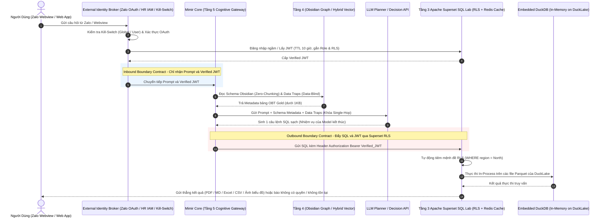
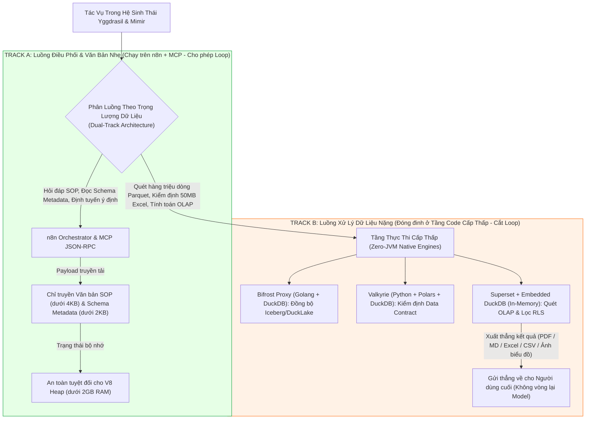
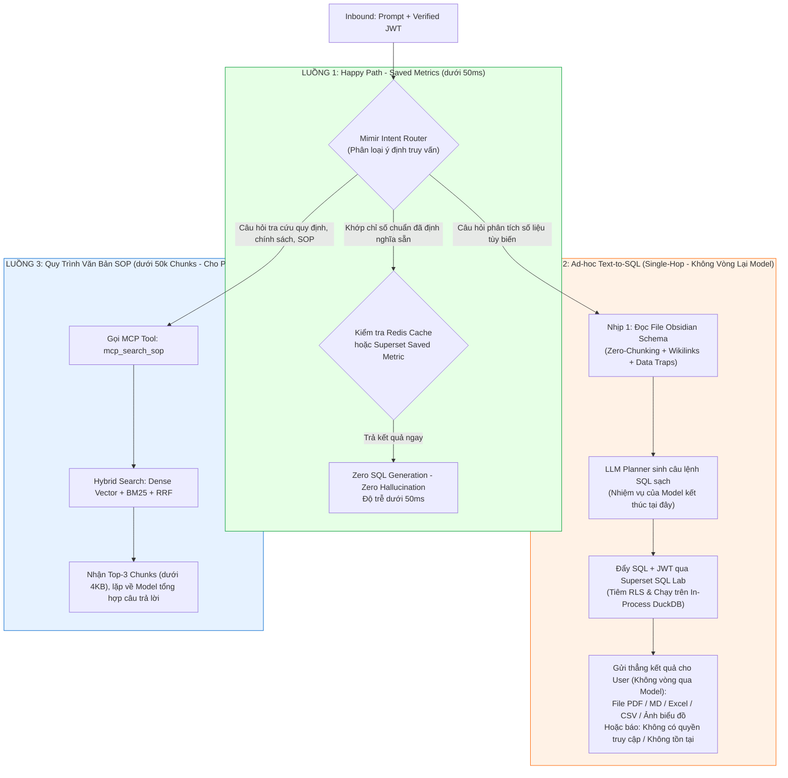
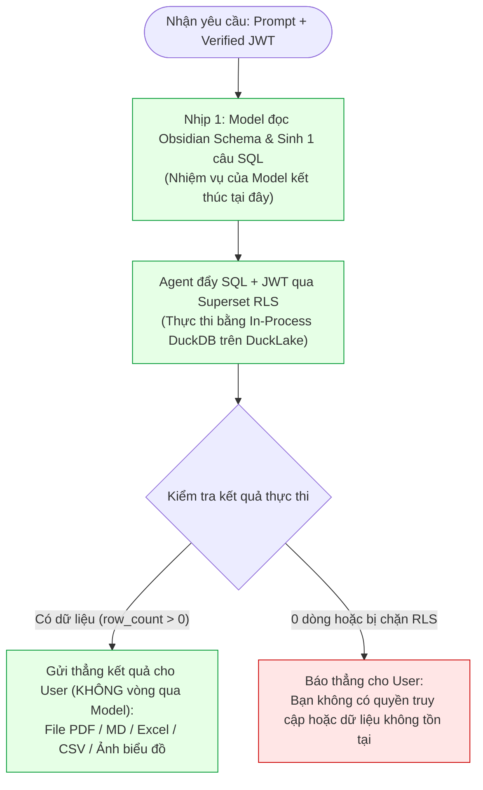

# Tầng 5 Mimir Core: Cognitive Gateway, Định Tuyến Luồng Kép & Cầu Dao Single-Hop

> **Tài liệu Kỹ thuật Tầng 5 (AI Gateway & Orchestration Layer) — Hệ sinh thái Yggdrasil Data Platform**  
> **Trạng thái:** Design / Proposed  

---

## 1. Ranh Giới Mimir Core & Giao Ước Biên (Security Boundary Contract)

Trong bản thiết kế tổng thể của **Yggdrasil Data Platform**, Tầng 5 vốn bao gồm cả các luồng tích hợp ngoại vi như xác thực Zalo Webview OAuth, đồng bộ bảng phân quyền nhân sự từ Google Sheet (Master IAM Sheet) của phòng HR, và kịch bản tự động cấp phát tài khoản trên n8n. Tuy nhiên, nếu nhồi nhét toàn bộ các tác vụ quản trị kênh chat đó vào chung với lõi định tuyến RAG & Text-to-SQL, kiến trúc của **Mimir** sẽ bị rối loạn trách nhiệm.

Vì vậy, repository này định nghĩa ranh giới rõ ràng giữa **Biên Ngoại Vi (External Channel & Identity Broker)** và **Lõi Nhận Thức (Mimir Core — Tầng 4 & Tầng 5)**:

> [!IMPORTANT]
> **Phân Định Rõ Vai Trò Các Phân Hệ Trong Yggdrasil:**
> * **Valkyrie (Tầng 2):** Là *Data Contract & Circuit Breaker Engine* (Python + DuckDB SQL Compiler) chặn dữ liệu bẩn ở tầng Ingestion/Storage.
> * **Bifrost Proxy (Tầng 2/3):** Là *Iceberg REST Catalog & DuckLake Sync Gateway* (Golang + DuckDB) đồng bộ metadata vào PostgreSQL DuckLake.
> * **External Channel & Identity Broker (Biên Ngoại Vi Tầng 5):** Đảm nhiệm Zalo Webview OAuth, đồng bộ Google Sheet Master IAM của HR, Rate-Limiting và **Cầu dao hủy khẩn cấp 2 cấp (Two-Tier Kill-Switch)** trước khi gói tin chạm vào Mimir Core.
> * **Mimir Core (Tầng 4 & Tầng 5 — Repo này):** Chỉ nhận gói tin đã xác thực (`Prompt + Verified JWT`), điều phối qua 3 luồng nhận thức, tra cứu Tầng 4 (Obsidian / Hybrid Vector) và ủy thác thực thi SQL có phân quyền xuống **Apache Superset SQL Lab (Tầng 3)**.

### 1.1 Giao Ước Biên Vào (Inbound Contract) & Cầu Dao 2 Cấp Ở Ngoại Vi

Trước khi một yêu cầu được phép đi vào **Mimir Core**, lớp **External Identity Broker** (vận hành trên n8n ở rìa ngoài Tầng 5) thực thi:
1. **Đồng bộ IAM từ Google Sheet & Cấp phát JWT 10 Giờ:** Phòng HR quản lý danh sách nhân sự, phòng ban, khu vực và cờ trạng thái (`Active` / `Suspended`) trên Master Google Sheet. Khi nhân viên mở Zalo Webview, hệ thống đối chiếu email/Zalo ID để lấy **Verified JWT** từ Apache Superset với thời hạn (TTL) **10 tiếng** — khớp trọn vẹn một ca làm việc hành chính.
2. **Cầu Dao Hủy Khẩn Cấp 2 Cấp (Two-Tier Kill-Switch trên Google Sheet Master IAM):**
   * **Cấp độ 1 — Thu hồi phiên (`Revoke Session` khi mất điện thoại / đăng nhập máy lạ):** HR hoặc IT chỉ cần tích vào ô `Revoke Session` bên cạnh tên nhân viên trên Master IAM Sheet. Hệ thống n8n lập tức xóa sạch ánh xạ `Zalo_User_ID <-> JWT Token` trong Database bảo mật; kẻ gian cầm điện thoại cũ bị chặn đứng ngay lập tức, trong khi tài khoản Superset gốc vẫn an toàn để nhân viên đăng nhập lại qua Webview trên thiết bị mới.
   * **Cấp độ 2 — Cắt đứt hoàn toàn (`Inactive` khi nhân sự nghỉ việc / sa thải):** Khi HR đổi trạng thái nhân sự thành `Inactive` trên Sheet, n8n thực hiện xử lý kép: vừa xóa sạch Token phiên trên Zalo, vừa gọi API Superset chuyển `is_active = False` để khóa vĩnh viễn tài khoản gốc trong vòng chưa đầy 1 phút.
3. **Đầu Vào Sạch Của Mimir Core:** Nhờ lớp lọc ngoại vi trên, **Mimir Core** hoàn toàn không chứa mã nguồn quản lý mật khẩu hay OAuth; nó chỉ nhận duy nhất cặp `{Prompt, Verified JWT}`.

### 1.2 Giao Ước Biên Ra (Outbound Contract) Qua Superset RLS

Mimir **không bao giờ** dùng tài khoản Admin/Root để chạy SQL trực tiếp xuống cơ sở dữ liệu:
* Mọi câu lệnh SQL do LLM sinh ra đều bắt buộc đính kèm `Verified JWT` của chính người dùng đó và gửi vào API của **Apache Superset SQL Lab**.
* Superset giải mã JWT, xác định vai trò (Role) của người dùng và tự động tiêm bộ lọc **Row-Level Security (RLS)** vào câu lệnh SQL (ví dụ: nhân viên kinh doanh miền Bắc bị ép cứng mệnh đề `WHERE region = 'North'`) trước khi giao cho **Embedded In-Process DuckDB (`duckdb:///:memory:`)** quét dữ liệu trên **DuckLake**.
* Ngay cả khi người dùng dùng thủ thuật *Prompt Injection* để ra lệnh cho AI *"Hãy lấy doanh thu của miền Nam"*, câu lệnh thực thi tại Superset vẫn bị khóa bởi `WHERE region = 'North'`, trả về `0` dòng và bảo toàn tuyệt đối an ninh dữ liệu.

---

## 2. Kiến Trúc Định Tuyến Luồng Kép (Dual-Track Routing) & Bảo Vệ V8 Heap

Các công cụ điều phối luồng hiện đại như **n8n** chạy trên nền tảng **Node.js (V8 JavaScript Engine)** với giới hạn bộ nhớ vật lý rất chặt (thường chỉ từ **`1.4GB – 2GB` RAM** cho toàn bộ tiến trình V8 Heap). Tương tự, giao thức **MCP (Model Context Protocol)** truyền tải dữ liệu qua chuỗi văn bản **JSON-RPC 2.0**.

Nếu thiết kế ngây thơ cho phép AI Agent hoặc n8n kéo một bảng dữ liệu thô `50MB` (vài trăm ngàn dòng giao dịch) đi qua ống dẫn JSON-RPC hoặc nạp vào biến bộ nhớ của n8n, cấu trúc đối tượng JSON khi giải mã sẽ phình gấp nhiều lần và kích nổ lỗi **`JavaScript heap out of memory (V8 Heap OOM)`**, đánh sập toàn bộ hệ thống điều phối.

Để giải quyết bài toán vật lý này, Mimir thiết lập kiến trúc **Dual-Track Routing (Định tuyến Luồng Kép)**:

### Quy Tắc Vận Hành Của Dual-Track Routing:
1. **Track A (Lightweight Text / Metadata / Orchestration):** Cho phép chạy qua **n8n + MCP Server** và lặp tự nhiên (`LLM Loop`) vì dữ liệu đi qua ống dẫn JSON-RPC chỉ là vài đoạn quy trình SOP (`< 4KB`) hoặc file mô tả Schema Obsidian (`< 2KB`).
2. **Track B (Heavy Data Processing & OLAP Execution):** Tuyệt đối cấm n8n hay MCP Tool tự kéo dữ liệu thô về bộ nhớ để lọc hay cộng trừ, và cấm trả bảng dữ liệu ngược về cho Model. Mọi tác vụ nặng (xử lý file Excel 50MB, quét hàng triệu dòng lịch sử giao dịch, JOIN/GROUP BY dữ liệu lớn) bị đóng đinh hoàn toàn ở tầng thực thi cấp thấp (**Golang tại `Bifrost Proxy`, Polars/DuckDB tại `Valkyrie`, và In-Process DuckDB tại `Superset`**). Sau khi Superset/DuckDB tính toán xong, kết quả (`PDF`, `MD`, `Excel`, `CSV`, `Ảnh biểu đồ`) được gửi thẳng về cho người dùng cuối mà không quay lại Model.

---

## 3. Ba Luồng Định Tuyến Nhận Thức (The 3 Cognitive Routing Flows)

Khi một câu hỏi của người dùng đi vào **Mimir Core**, bộ phân loại ý định (**Intent Router**) sẽ định tuyến yêu cầu vào đúng 1 trong 3 luồng chuyên biệt:

### 3.1 Luồng 1: Happy Path — Intent Router to Saved Metrics (`< 50ms`, Zero-SQL)
* **Bản chất:** 80% câu hỏi hàng ngày của ban giám đốc và các trưởng bộ phận xoay quanh một tập hợp cố định các chỉ số KPI cốt lõi (Doanh thu thuần hôm nay, Tỷ lệ hoàn đơn trong tuần, Tồn kho theo khu vực...).
* **Cơ chế:** Thay vì bắt LLM viết lại câu lệnh SQL mỗi lần được hỏi (vừa tốn tiền token, vừa chậm, vừa có rủi ro viết lệch công thức), **Intent Router** khớp thẳng ý định người dùng vào danh mục **Saved Metrics / Datasets** đã được định nghĩa chuẩn trên **Apache Superset** và lưu đệm trên **Redis Cache**.
* **Hiệu năng:** Không sinh bất kỳ câu lệnh SQL tự do nào (**Zero SQL — Zero Hallucination**), kết quả (số liệu / ảnh biểu đồ) trả thẳng về cho người dùng dưới **`50ms`**.

### 3.2 Luồng 2: Ad-hoc Data Text-to-SQL (Chạy Qua Obsidian Graph & Superset RLS — Trả Thẳng Về User)
* **Bản chất:** Dành cho 20% các câu hỏi phân tích chuyên sâu, cắt lát dữ liệu đa chiều chưa từng được tạo sẵn trên Dashboard.
* **Cơ chế:**
  1. Mimir nạp file **Obsidian Atomic Markdown** của bảng Gold OBT liên quan (kèm các file liên kết `[[Wikilinks]]` và khối cảnh báo `> [!WARNING] DATA_TRAP`).
  2. **Model (LLM Planner)** sinh câu lệnh SQL tuân thủ nghiêm ngặt công thức trong Data Trap (ví dụ: dùng `SUM(quantity * unit_price)` thay vì `total_price`, lọc `is_deleted = false`). **Nhiệm vụ của Model kết thúc ngay tại đây.**
  3. Câu lệnh SQL kèm `Verified JWT` được đẩy xuống **Superset SQL Lab** để tiêm mệnh đề RLS và chạy trên **In-Process DuckDB (`DuckLake`)**.
  4. **Trả thẳng cho User (Không vòng lại Model):** Nếu có dữ liệu, hệ thống gửi thẳng kết quả dưới dạng **file `PDF`, `Markdown (.md)`, `Excel`, `CSV`, hoặc `Ảnh biểu đồ`** về cho người dùng cuối. Nếu không có dữ liệu (do không tồn tại bản ghi hoặc bị RLS chặn), hệ thống báo thẳng: ***"Bạn không có quyền truy cập hoặc dữ liệu không tồn tại"***.

### 3.3 Luồng 3: Tra Cứu Quy Trình Văn Bản SOP (Chạy Qua MCP Hybrid Search — Cho Phép Loop)
* **Bản chất:** Giải đáp các câu hỏi về quy chế công ty, quy trình kế toán, hướng dẫn vận hành chuẩn (SOP).
* **Cơ chế:** Agent gọi công cụ MCP `mcp_search_sop` truy vấn vào **Vector DB + BM25** (quy mô `< 50,000 chunks`), hợp nhất thứ hạng bằng thuật toán **RRF** để lấy ra Top-3 đoạn văn bản chuẩn xác nhất (`< 4KB`). Trên luồng này, `LLM Loop` được phép lặp bình thường để đối chiếu đủ thông tin rồi tổng hợp câu trả lời kèm trích dẫn nguồn.

---

## 4. Cầu Dao Thực Thi Một Nhịp (Single-Hop Circuit Breaker)

Trong các framework như LangChain/LangGraph, một Agent được khuyến khích tự do lặp vòng (`Thought -> Action -> Observation -> Thought -> Action...`) qua hàng loạt công cụ khác nhau. Khi áp dụng vào hệ thống dữ liệu doanh nghiệp, sự tự do này gây ra 3 thảm họa:
1. **Lộ dữ liệu thô & Nổ bộ nhớ V8 Heap:** Nếu trả bảng kết quả SQL (như file Excel hàng chục nghìn dòng) ngược về cho Model đọc để tóm tắt hoặc truyền từ Tool A sang Tool B, vừa vi phạm nguyên tắc **Data-Blind AI**, vừa làm sập bộ nhớ V8 Heap của n8n và tràn Context Window.
2. **Vòng lặp tự sửa SQL mù quáng (Runaway SQL Retry Loops):** Khi viết câu lệnh SQL bị lỗi hoặc trả về 0 dòng, Agent tự ý sửa điều kiện `WHERE` (thậm chí tự ý bỏ điều kiện lọc `is_deleted = false`) để cố lấy bằng được số liệu, dẫn tới báo cáo sai sự thật và đốt sạch ngân sách token.
3. **Biến dạng ngữ cảnh qua nhiều bước (Multi-Hop Context Drift):** Càng đi qua nhiều bước gọi tool, **Prompt Entropy** càng tăng, làm mô hình quên mất câu hỏi gốc ban đầu.

### Kỷ Luật Sắt Của Single-Hop Circuit Breaker Trong Mimir (Chỉ Cắt Loop Với Luồng Gọi Data):
* **Bản chất của Agent là một vòng lặp gọi Model (`LLM Loop`):** Với **Luồng 3 (Tra cứu văn bản quy trình SOP — Track A)**, do mỗi lần gọi MCP Tool chỉ trả về vài đoạn văn bản nhẹ (`< 4KB`) và không có rủi ro sai lệch số liệu tài chính, **Agent cứ việc chạy `LLM Loop` lặp bình thường** để tra cứu chéo các quy định cho tới khi đủ thông tin trả lời.
* **Cắt sạch vòng lặp trên Luồng Gọi Dữ Liệu (Luồng 2 Text-to-SQL — Track B):** Riêng khi đụng tới cơ sở dữ liệu, **Model chỉ được gọi đúng 1 nhịp để sinh câu lệnh SQL**. Ngay sau đó, kết quả thực thi từ Superset/DuckDB (`PDF`, `MD`, `Excel`, `CSV`, `Ảnh biểu đồ` hoặc thông báo *"Bạn không có quyền truy cập hoặc dữ liệu không tồn tại"*) **được gửi thẳng tới người dùng cuối mà không bao giờ vòng ngược lại qua Model nữa** — bảo toàn tuyệt đối **Data-Blind AI**, tiết kiệm 50% độ trễ/token và triệt tiêu 100% hành vi tự lặp vòng đoán mò sửa câu lệnh SQL.
