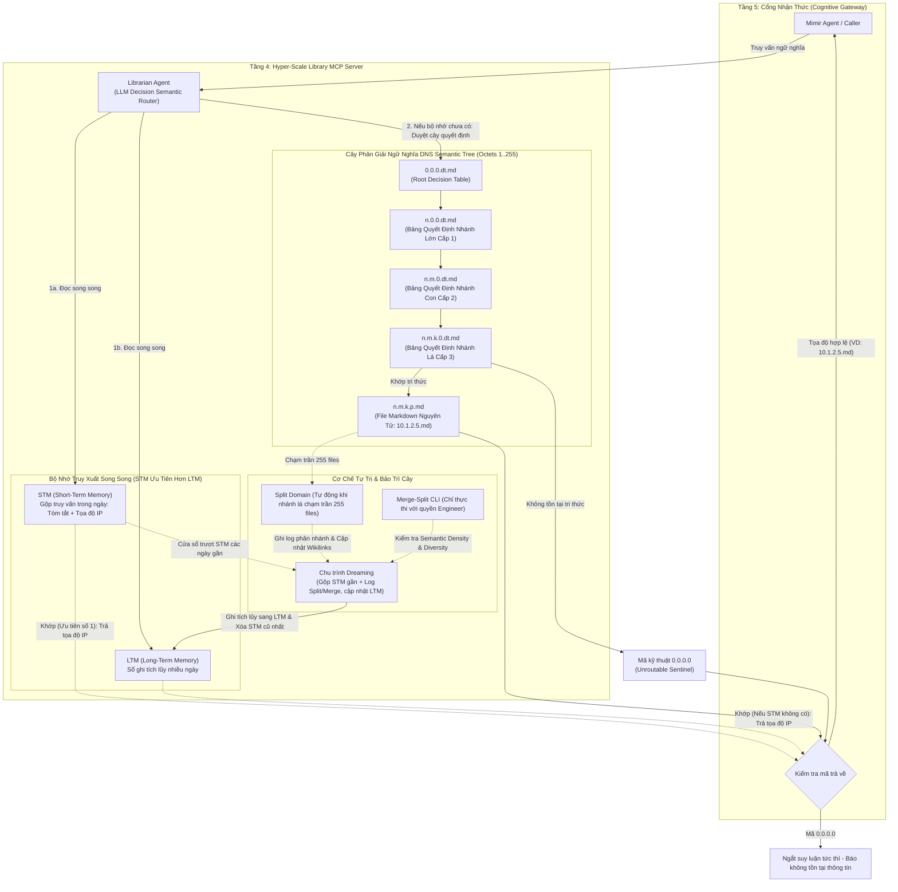
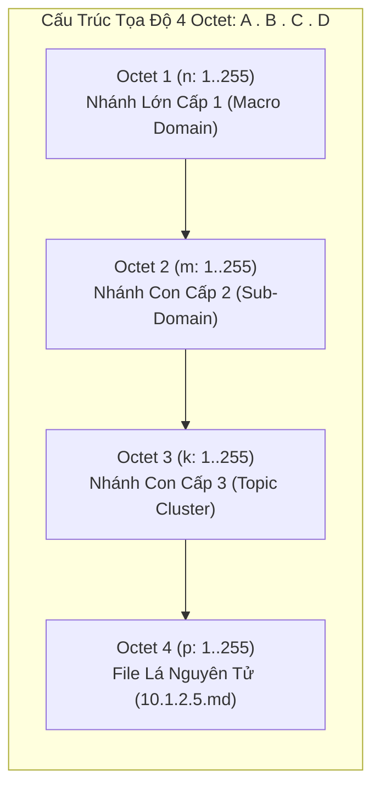
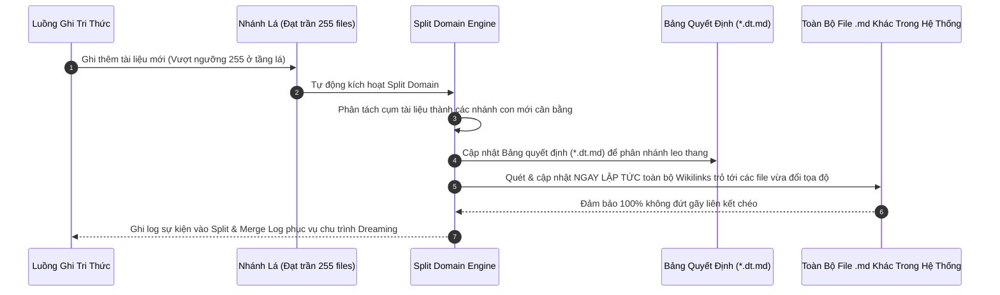
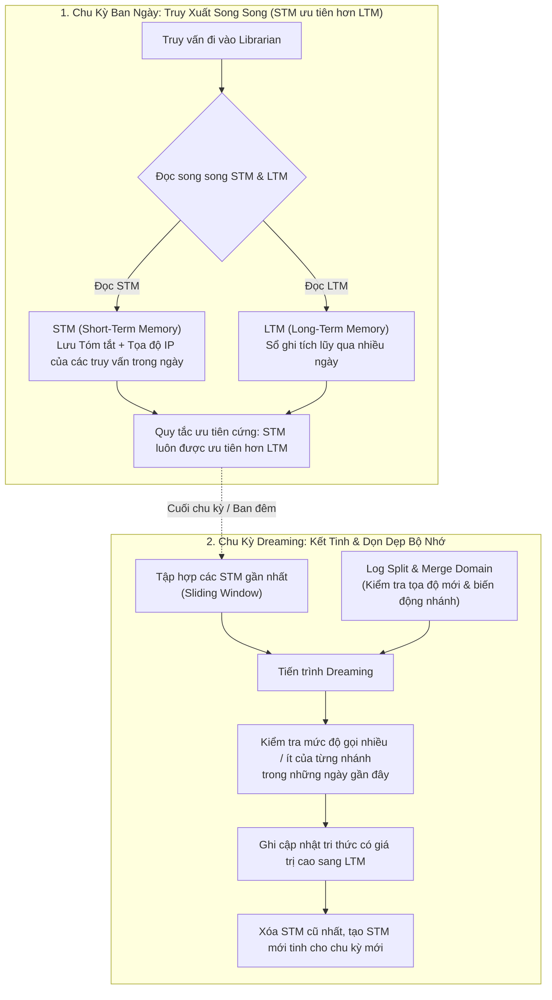

# Đặc Tả Cỗ Máy Hyper-Scale Library MCP Blueprint (Quy Mô 4M – 5M+ Chunks)

> **Tài liệu Kỹ thuật Tầng 4 (Knowledge & Semantic Layer) — Hệ sinh thái Yggdrasil Data Platform**  
> **Trạng thái:** Verified R&D Blueprint (Đã hiện thực hóa & đo kiểm nội bộ — Mã nguồn đóng / Proprietary, chỉ công bố Đặc tả Kiến trúc)  

---

## 1. Bản Chất Cỗ Máy Hyper-Scale Library MCP

Khi một tổ chức tài chính hoặc tập đoàn lớn tích lũy từ **4 đến 5 triệu phân đoạn tri thức (chunks)**, không gian Vector Database 1,536 chiều rơi vào trạng thái **Sụp đổ mật độ vector (Vector Density Collapse)** — hàng ngàn tài liệu khác nhau có điểm tương đồng Cosine tụ lại trong dải hẹp `0.898 – 0.899`, làm tê liệt hoàn toàn thuật toán tìm kiếm lân cận (Top-K Retrieval).

Để giải quyết bài toán ở quy mô cực đại này mà không dùng Chunking/Overlap và không phụ thuộc vào tìm kiếm Cosine mù quáng, kiến trúc **Hyper-Scale Library** được thiết kế như một **MCP Server độc lập** bao gồm 4 cấu phần gắn kết chặt chẽ:
1. **`Librarian` (Semantic Decision Router Agent):** Con Agent điều phối nằm ở lõi của Library, vận hành bằng một **Decision Model / LLM Semantic Router** chạy theo cơ chế ra quyết định phân cấp (Decision-based Routing) chứ không dùng tìm kiếm tương đồng vector.
2. **`DNS Semantic Tree`:** Cây phân giải tọa độ ngữ nghĩa 4 bậc (`A.B.C.D`) lấy cảm hứng từ cấu trúc địa chỉ IPv4, quản lý các file Markdown nguyên tử (`10.1.2.5.md`) và các Bảng quyết định điều hướng (`*.dt.md`).
3. **`STM` (Short-Term Memory) & `LTM` (Long-Term Memory):** Hệ thống bộ nhớ truy xuất song song, trong đó `STM` lưu kết quả truy vấn phát sinh trong ngày kèm tọa độ IP và luôn được ưu tiên tuyệt đối hơn `LTM` (sổ ghi tích lũy dài hạn nhiều ngày).
4. **`Dreaming` (Consolidation Cycle):** Chu trình chạy ngầm gộp thông tin các `STM` gần nhất cùng nhật ký phân tách/gộp nhánh (`Split & Merge Logs`) để kiểm tra tần suất truy cập, cập nhật tri thức bền vững sang `LTM`, sau đó xóa `STM` cũ nhất và khởi tạo `STM` mới cho chu kỳ tiếp theo.

---

## 2. Quy Tắc Đánh Số Cây `DNS Semantic Tree` & Hệ Thống Mã Kỹ Thuật Octet `0`

Cấu trúc địa chỉ của `DNS Semantic Tree` gồm 4 bậc số nguyên phân cách bởi dấu chấm (`A.B.C.D`), tương tự IPv4 nhưng tuân thủ quy ước định tuyến ngữ nghĩa nghiêm ngặt:

### 2.1 Dải Tọa Độ Tri Thức Thực (`1` đến `255`)
* Mọi nhánh và file dữ liệu thực tế chỉ được phép đánh số từ **`1` đến `255`**.
* Khi `Librarian` phân giải xong chuỗi tọa độ (ví dụ `10.1.2.5`), hệ thống lập tức ánh xạ thẳng sang đường dẫn lưu trữ để lấy file Markdown nguyên tử **`10.1.2.5.md`** mà không cần quét tìm kiếm toàn cục.
* Trần tối đa **255 thực thể trên mỗi cấp nhánh** giữ cho mọi Bảng quyết định không bao giờ vượt quá ngưỡng gây **Prompt Entropy** cao khi nạp vào `Librarian`.

### 2.2 Vùng Cấm Octet `0`: Mã Lỗi & Mã Điều Khiển Kỹ Thuật (Technical Control Codes)
Số **`0`** tuyệt đối không bao giờ được gán cho tài liệu nghiệp vụ thông thường; đây là khu vực dành riêng cho **nhánh gãy, mã trả lỗi và mã lệnh cấp phát nhánh mới**:

| Mã Kỹ Thuật / Tệp Điều Hướng | Bản Chất & Hành Vi Thực Thi Chính Xác Trong Hệ Thống |
| :--- | :--- |
| **`0.0.0.0`** *(Unroutable Sentinel)* | **Mã trả lỗi không tồn tại tri thức:** Khi `Librarian` duyệt cây nhưng không có nhánh nào chứa thông tin phù hợp, nó trả về `0.0.0.0` để ép Agent dừng suy luận ngay lập tức, chặn đứng 100% hành vi tự đoán mò (Hallucination). |
| **`0.1.0.0`** *(Allocate New Level-1 Branch)* | **Mã ghi nhánh lớn cấp 1 mới:** Khi xuất hiện một miền tri thức hoàn toàn mới chưa từng có ở tầng gốc, hệ thống phát mã `0.1.0.0` để ghi file mới vào nhánh **`(n+1).1.1.1.md`**, sau đó cập nhật ngay vào Bảng quyết định gốc `0.0.0.dt.md`. |
| **`n.0.1.0`** *(Allocate New Level-2 Sub-branch)* | **Mã tạo nhánh con cấp 2 mới trong nhánh lớn `n`:** Ghi file mới tại tọa độ **`n.(m+1).1.1.md`**, đồng thời cập nhật Bảng quyết định của nhánh lớn `n` (`n.0.0.dt.md`). |
| **`n.m.0.1`** *(Allocate New Level-3 Sub-branch)* | **Mã tạo nhánh con cấp 3 mới trong nhánh `n.m`:** Ghi file mới tại tọa độ **`n.m.(k+1).1.md`**, đồng thời cập nhật Bảng quyết định `n.m.0.dt.md`. |
| **`0.0.0.dt.md`**, **`n.0.0.dt.md`**, **`n.m.0.dt.md`** | **Các tệp Bảng Quyết Định (Decision Tables):** Mang hậu tố `.dt.md` để tách biệt hoàn toàn với vùng mã lỗi `0.0.0.0`. `Librarian` đọc các file `.dt.md` này để chọn nhánh đi xuống ở từng tầng. |

---

## 3. Cơ Chế Phân Nhánh Leo Thang Tự Động (`Split Domain`) & Đồng Bộ `[[Wikilinks]]`

Khi một nhánh ở tầng lá tiếp nhận thêm tài liệu mới và **chạm trần 255 files**, hệ thống tự động kích hoạt cơ chế **`Split Domain`** để phân nhánh leo thang:

### Hai Quy Tắc Bất Biến Khi Chạy `Split Domain`:
1. **Bảo Toàn Khu Vực Mã Kỹ Thuật `0`:** Quá trình phân nhánh leo thang chỉ cập nhật vào các tệp **Bảng quyết định (`*.dt.md` như `0.0.0.dt.md`)** và cấp phát tọa độ mới từ `1..255`, tuyệt đối không ghi đè hay xâm phạm vào khu vực mã lỗi kỹ thuật `0.0.0.0`.
2. **Đồng Bộ Tức Thời `[[Wikilinks]]` Toàn Hệ Thống:** Do các file Markdown nguyên tử trong kho tri thức liên kết chéo với nhau qua `[[Wikilinks]]`, ngay tại thời điểm một file lá được dời sang tọa độ IP mới sau khi tách nhánh, toàn bộ các file `.md` khác trong hệ thống có chứa `[[Wikilinks]]` trỏ tới file đó **bắt buộc phải được cập nhật lại đường dẫn ngay lập tức** (Atomic Link Rewrite) để không bao giờ xảy ra lỗi đứt gãy tham chiếu.

---

## 4. Cơ Chế Tái Cân Bằng Cây Chủ Động (`Merge-Split Domain` Qua CLI)

Nếu `Split Domain` diễn ra tự động khi nhánh lá chạm trần số lượng 255, thì thao tác **`Merge Domain` (gộp và tái phân chia nhánh)** mang tính rủi ro cấu trúc cao hơn rất nhiều và tuân theo quy định vận hành nghiêm ngặt:

* **Chỉ Thực Hiện Với Quyền Của Engineer Qua CLI:** Hệ thống **tuyệt đối không tự động chạy `Merge Domain` ngầm**. Thao tác này bắt buộc phải do kỹ sư (Engineer) có thẩm quyền kích hoạt nhưng được công cụ CLI của hệ thống hỗ trợ tính toán sâu.
* **Kiểm Tra Mật Độ (`Semantic Density`) & Độ Phân Tán (`Semantic Diversity`):**
  * CLI quét qua các nhánh trên cây để đo lường **mật độ ngữ nghĩa (`Semantic Density`)** và **độ phân tán / độ phủ chủ đề (`Semantic Diversity`)** của từng nhánh.
  * Khi phát hiện các nhánh bị lệch (ví dụ: nhánh quá thưa do chủ đề cũ ít dùng, hoặc hai nhánh lân cận bị chồng lấn ranh giới ngữ nghĩa), kỹ sư thực thi thao tác **`Merge-Split`**: gộp chung các nhánh bị lệch lại rồi phân tách lại thành 2 hoặc nhiều nhánh mới sao cho **mật độ và độ phủ của mỗi nhánh trong toàn hệ thống luôn tương đối cân bằng**.
* **Cập Nhật Tức Thời `[[Wikilinks]]` & Ghi Log:** Tương tự như khi tách nhánh, mọi thay đổi tọa độ sau khi chạy CLI `Merge-Split` đều tự động cập nhật lại toàn bộ `[[Wikilinks]]` trong hệ thống và xuất nhật ký vào `Split & Merge Log`.

---

## 5. Bộ Nhớ `STM` / `LTM` & Chu Trình Kết Tinh Tri Thức `Dreaming`

Để `Librarian` không phải duyệt lại từ gốc `0.0.0.dt.md` cho những câu hỏi lặp đi lặp lại trong doanh nghiệp, `Hyper-Scale Library` trang bị hai tầng bộ nhớ truy xuất song song kết hợp với chu trình làm sạch ban đêm **`Dreaming`**:

### Ba Nguyên Tắc Vận Hành Bộ Nhớ Của Library:
1. **`STM` Luôn Được Ưu Tiên Tuyệt Đối Hơn `LTM`:** Khi một câu hỏi được gửi tới, `Librarian` tra cứu song song cả `STM` và `LTM`. Nếu có xung đột hoặc có bản ghi mới trong `STM`, kết quả từ **`STM` luôn được ưu tiên chọn trước `LTM`** để phản ánh tức thì các tri thức và tọa độ vừa phát sinh trong ngày.
2. **Định Dạng Bản Ghi `STM` Tinh Gọn:** Mỗi mục ghi trong `STM` chỉ lưu đúng **bản tóm tắt ngữ nghĩa của truy vấn kèm theo tọa độ IP đích** (ví dụ `10.1.2.5.md`), giúp `Librarian` nhảy thẳng tới file đích trong một bước.
3. **Cơ Chế Chu Trình `Dreaming`:**
   * Đến chu kỳ nghỉ (hoặc khi gom đủ batch), tiến trình **`Dreaming`** sẽ đọc gộp thông tin của **các `STM` gần nhất** cộng với **nhật ký `Log Split & Merge`** để kiểm tra mức độ gọi nhiều hay ít (tần suất truy cập thực tế) của các nhánh trong những ngày gần đây và đồng bộ lại tọa độ nếu nhánh vừa bị tách/gộp.
   * Những tri thức có tần suất gọi cao và ổn định được đúc kết ghi sang **`LTM`**.
   * Ngay sau khi cập nhật `LTM` hoàn tất, hệ thống **xóa bỏ `STM` cũ nhất** và **khởi tạo một `STM` mới** cho chu kỳ ngày tiếp theo (có thể tận dụng *Batch API* giảm 50% chi phí hoặc chạy bằng *Local SLM* để tiết kiệm 65–70% ngân sách vận hành bộ nhớ).

---

## 6. Vị Trí Của Blueprint Này Trong Lộ Trình Mimir

Cỗ máy **Hyper-Scale Library MCP** là lời giải hoàn chỉnh về mặt lý thuyết thông tin để trị tận gốc *Prompt Entropy* và *Vector Density Collapse* ở quy mô hàng triệu tài liệu (đạt **95 – 98 điểm `ndcg_at_10`** trên bộ benchmark MTEB Finance).

Tuy nhiên, cái giá phải trả để vận hành cỗ máy này là **`$140 – $160 / 1B tokens`** cùng yêu cầu kỹ thuật vận hành cực kỳ khắt khe (đòi hỏi kỹ sư hiểu sâu về `Semantic Density` và `Semantic Diversity` của RAG để điều khiển CLI `Merge-Split` mà không làm mù nhánh). Lý do chúng tôi quyết định đóng băng Blueprint này ở trạng thái dự phòng và thu gọn kiến trúc thực tế về **Hybrid Vector Search + Obsidian Graph** được phân tích minh bạch tại [05_deescalation_and_fin_benchmarks.md](./05_deescalation_and_fin_benchmarks.md).
