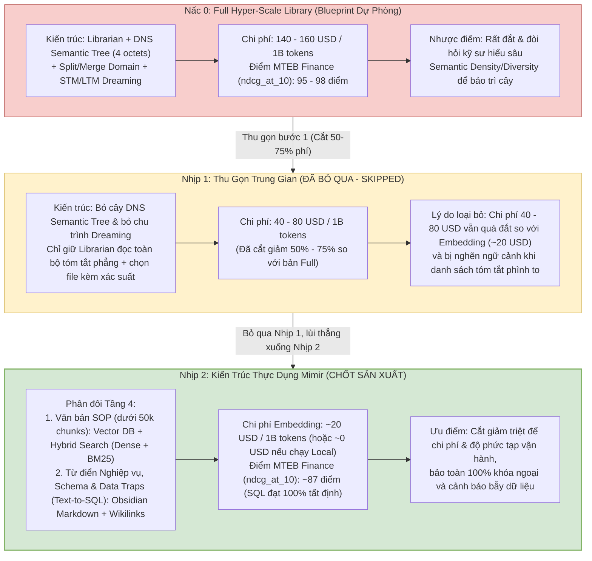

# Post-Mortem Over-Engineering, Lộ Trình Thu Gọn & Đối Chuẩn 7 Tác Vụ MTEB Finance

> **Tài liệu Kỹ thuật Tầng 4 & Tầng 5 — Hệ sinh thái Yggdrasil Data Platform**  
> **Trạng thái:** Empirical Post-Mortem & Benchmark Report (Số liệu thực nghiệm từ bản build R&D nội bộ của `Library`)  

---

## 1. Post-Mortem: Thừa Nhận Căn Bệnh "Over-Engineering" (Engineer's Hubris)

Tài liệu này ghi lại một cách thẳng thắn quá trình tự nhìn nhận sai lầm thiết kế quá đà (**Over-Engineering**) khi xây dựng Tầng 4 và Tầng 5 của Yggdrasil, cùng lộ trình thu gọn dần để đạt được kiến trúc **Mimir** thực dụng như hiện tại.

Khi bắt đầu thiết kế hệ thống RAG cho dữ liệu tài chính và doanh nghiệp, chúng tôi đã bị cuốn vào việc giải bài toán ở quy mô cực đại (`4 – 5 triệu chunks`) và chế tạo ra cỗ máy **Hyper-Scale Library MCP** ([04_hyper_scale_library_blueprint.md](./04_hyper_scale_library_blueprint.md)) với cây `DNS Semantic Tree` 4 bậc, `Split/Merge Domain` và chu trình `Dreaming`.

Nhưng khi đặt cỗ máy đó vào bối cảnh thực tế của đại đa số doanh nghiệp (quy mô tài liệu quy trình SOP `< 50,000 chunks` và khoảng vài chục bảng phân tích SQL OBT Gold), chúng tôi nhận ra mình đã rơi vào bẫy **Engineer's Hubris** vì hai rào cản chí mạng:
1. **Bài toán Kinh tế (Unit Economics):** Chi phí chạy `Librarian` duyệt cây quyết định lên tới **`$140 – $160 / 1 tỷ token`**, đắt gấp **7 đến 8 lần** so với các mô hình Embedding thương mại (`~$20 / 1 tỷ token`), trong khi chênh lệch chất lượng trên tập văn bản nhỏ là không đủ lớn để đánh đổi.
2. **Bài toán Kỹ thuật Vận hành (Operational Skill Ceiling):** Vấn đề của `Library` **không chỉ vì nó đắt**, mà vì nó đòi hỏi một trình độ vận hành vượt quá khả năng của các đội kỹ thuật bình thường (xem Mục 4 bên dưới).

---

## 2. Lộ Trình Thu Gọn Kiến Trúc (De-Escalation Path: Từ Nấc 0 Xuống Thẳng Nhịp 2)

Quá trình cắt giảm độ phức tạp được thực hiện qua lộ trình thu gọn rõ ràng: thử nghiệm thu gọn về **Nhịp 1**, nhận thấy vẫn chưa triệt để, và cuối cùng quyết định **bỏ qua luôn Nhịp 1 để lùi hẳn xuống Nhịp 2**:

### Tại Sao Bỏ Qua Luôn Nhịp 1 Để Xuống Thẳng Nhịp 2?
* **Ở Nhịp 1:** Chúng tôi bỏ cây `DNS Semantic Tree` và bỏ luôn chu trình `Dreaming`, chỉ để con `Librarian` đọc tất cả các bản tóm tắt tài liệu và các file quyết định rồi chấm xác suất chọn file nào. Cách này giúp cắt được **50% – 75% chi phí** so với bản Full (tức giảm từ `$140–$160` xuống còn **`$40 – $80 / 1 tỷ token`**).
* **Tuy nhiên:** Mức giá `$40 – $80 / 1 tỷ token` vẫn còn quá đắt đỏ khi đặt cạnh các mô hình Embedding (`~$20 / 1 tỷ token`), đồng thời khi số lượng bản tóm tắt tăng lên vài ngàn file, khối Prompt nhét vào `Librarian` lại phình to và gây trễ.
* **Quyết định dứt khoát (Nhịp 2):** Bỏ toàn bộ cơ chế dùng LLM làm bộ định tuyến văn bản; chuyển phần tài liệu quy trình SOP (`< 50k chunks`) sang chạy **Vector DB + Hybrid Search (Dense + BM25)**, còn phần Từ điển nghiệp vụ, Schema & Data Traps phục vụ Text-to-SQL thì giữ nguyên các **file Markdown nguyên tử + `[[Wikilinks]]` trên Obsidian** để bảo toàn 100% liên kết khóa ngoại và cảnh báo bẫy dữ liệu.

---

## 3. Đối Chuẩn Thực Nghiệm Trên 7 Tác Vụ MTEB Financial Retrieval (`ndcg_at_10`)

Để đánh giá chính xác mức độ đánh đổi chất lượng khi lùi từ `Hyper-Scale Library` (`95 – 98` điểm) xuống `Embedding / Hybrid Search` (`~87` điểm), chúng tôi đối chiếu trên bộ **7 tác vụ truy xuất tài chính tiêu chuẩn của MTEB (Massive Text Embedding Benchmark)** với thước đo chính là **`ndcg_at_10`**:

### 3.1 Danh Mục 7 Tác Vụ MTEB Financial Retrieval Được Sử Dụng

| # | Tên Tác Vụ (Task Name) | Ngôn Ngữ | Số Miền (Domains) | Thước Đo Chính (Main Metric) | Loại Tác Vụ & Mô Tả Bản Chất Bộ Dữ Liệu |
| :-: | :--- | :---: | :---: | :---: | :--- |
| **1** | **`FinanceBenchRetrieval`** | 1 (`en`) | 1 | `ndcg_at_10` | **Text Retrieval:** Tác vụ truy xuất báo cáo tài chính doanh nghiệp dựa trên bộ dữ liệu *FinanceBench* (báo cáo 10-K, 10-Q, bảng cân đối kế toán). |
| **2** | **`HC3FinanceRetrieval`** | 1 (`en`) | 1 | `ndcg_at_10` | **Text Retrieval:** Tác vụ truy xuất tài chính dựa trên bộ dữ liệu *HC3 Finance* chứa các cặp câu trả lời đối chiếu giữa chuyên gia người thật và AI. |
| **3** | **`FinQARetrieval`** | 1 (`en`) | 1 | `ndcg_at_10` | **Text Retrieval:** Tác vụ truy xuất tài chính dựa trên bộ dữ liệu *FinQA* đòi hỏi suy luận số học (numerical reasoning) trên văn bản và bảng biểu tài chính. |
| **4** | **`EnglishFinance1Retrieval`** | 1 (`en`) | 2 | `ndcg_at_10` | **Text Retrieval:** Bộ dữ liệu truy xuất tài liệu tài chính với các truy vấn về thù lao cổ phiếu (*stock compensation*), hồ sơ công bố doanh nghiệp (*corporate filings*). |
| **5** | **`EnglishFinance2Retrieval`** | 1 (`en`) | 2 | `ndcg_at_10` | **Text Retrieval:** Bộ dữ liệu truy xuất hiệu quả tài chính với các truy vấn về diễn biến cổ phiếu (*stock performance*), chỉ số *S&P 500*. |
| **6** | **`EnglishFinance3Retrieval`** | 1 (`en`) | 2 | `ndcg_at_10` | **Text Retrieval:** Bộ dữ liệu hỏi đáp tài chính cá nhân (*Personal finance Q&A*) với các câu hỏi về mã số thuế (*tax codes*), chi phí kinh doanh (*business expenses*). |
| **7** | **`EnglishFinance4Retrieval`** | 1 (`en`) | 2 | `ndcg_at_10` | **Text Retrieval:** Bộ dữ liệu tư vấn tài chính cá nhân (*Personal finance advice*) với các câu hỏi về vay mua xe (*car financing*), danh mục đầu tư (*investment*). |

### 3.2 Bảng So Sánh Tổng Hợp: Chi Phí vs. Điểm Số `ndcg_at_10` Trên 7 Tác Vụ

| Phương Án Kiến Trúc | Điểm Số Trên 7 Task MTEB Finance (`ndcg_at_10`) | Chi Phí Xử Lý (`$/1B Tokens`) | Độ Phức Tạp Vận Hành | Kết Luận Đánh Đổi (Trade-off Analysis) |
| :--- | :---: | :---: | :--- | :--- |
| **Nấc 0: Full Hyper-Scale Library** (`DNS Semantic Tree` + `Librarian` + `Dreaming`) | **`95 – 98` điểm** | **`$140 – $160`** | Cực kỳ phức tạp (Stateful Tree, CLI `Merge-Split`, `STM/LTM Dreaming`) | Đạt đỉnh chất lượng nhờ không dùng chunking và duyệt ngữ nghĩa nguyên khối, nhưng quá đắt và quá nặng vận hành cho quy mô `< 50k chunks`. |
| **Nhịp 1: Flat Summary + Probability** *(Chỉ `Librarian` đọc tóm tắt phẳng)* | `~90 – 92` điểm | **`$40 – $80`** *(Giảm 50–75%)* | Trung bình – Cao (Nghẽn cửa sổ ngữ cảnh khi số file tăng) | Dù đã cắt 50–75% chi phí nhưng vẫn đắt gấp 2–4 lần Embedding Model; không đáng giữ lại. |
| **Nhịp 2: Embedding / Hybrid Search (`Dense + BM25`) + Obsidian Graph** | **`~87` điểm** *(Văn bản)* & **`100%`** *(SQL Schema)* | **`~$20`** *(API)* hoặc **`~$0`** *(Local)* | **Thấp tối đa (Zero Ops)** — Quản lý file `.md` trên Git & Vector DB chuẩn | **Chênh lệch giữa `~87` điểm của các model Embedding và `95–98` điểm của `Library` (~8–11 điểm) là không đủ lớn** để biện minh cho mức giá đắt gấp 7–8 lần ở quy mô doanh nghiệp vừa và nhỏ. |

---

## 4. Phân Tích Tử Huyệt Vận Hành: Tại Sao `Library` Quá Khó Với Các Đội Kỹ Thuật Bình Thường?

Một hiểu lầm phổ biến là cho rằng `Hyper-Scale Library` khó triển khai vì gánh nặng **MLOps** (phải tự huấn luyện hay vận hành cụm GPU phức tạp). **Thực tế hoàn toàn không phải vậy:**
* **MLOps không phải là vấn đề lớn nhất:** Về mặt hạ tầng mô hình, con `Librarian` hoàn toàn có thể gọi trực tiếp các **Decision Model API** thương mại (hoặc chạy SLM nhẹ qua API) mà không cần đội ngũ MLOps đồ sộ.
* **Tử huyệt thực sự nằm ở Trần Kỹ Năng Vận Hành (`Semantic Density & Diversity` của RAG):**
  1. **Đòi hỏi người hiểu sâu về `Density` và `Diversity` của không gian ngữ nghĩa:** Cây `DNS Semantic Tree` là một cấu trúc có trạng thái (Stateful Tree). Khi dữ liệu mới liên tục đổ vào, các nhánh sẽ bị lệch mật độ. Để chạy công cụ CLI `Merge-Split` tái cân bằng cây, bắt buộc phải có một kỹ sư thực sự hiểu bản chất toán học của **Mật độ ngữ nghĩa (`Semantic Density`)** và **Độ phân tán chủ đề (`Semantic Diversity`)** trong RAG để quyết định khi nào cần gộp nhánh, khi nào cần chẻ nhánh thành 2 hay nhiều nhánh mới nhằm giữ cho độ phủ mỗi nhánh tương đối cân bằng. Với các đội kỹ thuật doanh nghiệp bình thường, yêu cầu nhân sự này là quá khó.
  2. **Rủi ro Mù Nhánh (`Subtree Blinding`):** Nếu một kỹ sư không hiểu rõ độ phân tán ngữ nghĩa mà cấu hình sai mô tả trong Bảng quyết định cha (`*.dt.md`) hoặc chạy `Merge-Split` lệch tay, `Librarian` sẽ rẽ nhầm hướng hoặc trả về mã `0.0.0.0`, làm "tàng hình" toàn bộ hàng chục ngàn tài liệu con nằm bên dưới nhánh đó.
  3. **Gánh nặng đồng bộ trạng thái kép:** Phải đảm bảo cơ chế cập nhật tức thời `[[Wikilinks]]` trên toàn hệ thống mỗi khi nhánh lá chạm trần 255 files và giám sát chu trình `Dreaming` gộp `STM` sang `LTM` mỗi đêm.

Ngược lại, khi lùi về **Nhịp 2 (Hybrid Vector + Obsidian `[[Wikilinks]]`)**:
* Các đội kỹ thuật bình thường chỉ cần viết file Markdown định nghĩa bảng SQL + `Data Traps` trên Obsidian và nạp tài liệu quy trình SOP vào Vector DB chạy `Dense + BM25`.
* Toàn bộ gánh nặng cân bằng mật độ nhánh (`Density / Diversity`) và rủi ro mù nhánh được xóa sổ hoàn toàn, trong khi chất lượng truy xuất thực tế vẫn đạt ngưỡng xuất sắc (**`~87` điểm `ndcg_at_10`** cho văn bản và **tất định 100%** cho Text-to-SQL).
