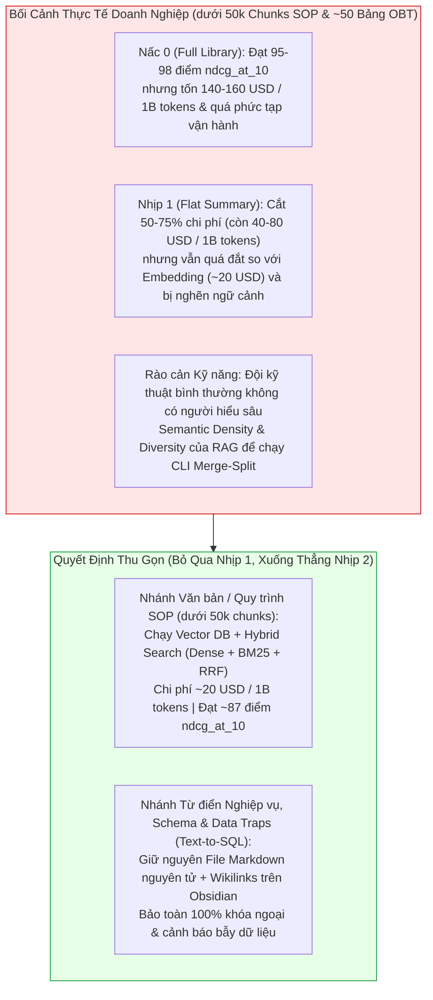

# ADR 0001: Thu Gọn Kiến Trúc Từ Hyper-Scale Library Về Hybrid Vector Và Obsidian Graph

> **Architecture Decision Record (ADR)**  
> **Trạng thái:** Accepted (Dựa trên kết quả thực nghiệm R&D nội bộ của `Hyper-Scale Library`)  
> **Ngày quyết định:** 2026-10-29  
> **Phạm vi kỹ thuật:** Tầng 4 (Knowledge & Semantic Layer) — Hệ sinh thái Yggdrasil Data Platform  

---

## 1. Context (Bối Cảnh)

Trong giai đoạn đầu thiết kế Tầng 4 của **Yggdrasil Data Platform**, chúng tôi đã xây dựng kiến trúc **Hyper-Scale Library MCP** ([../04_hyper_scale_library_blueprint.md](../04_hyper_scale_library_blueprint.md)) nhằm giải quyết triệt để hiện tượng **Prompt Entropy** (do băm nhỏ chunking/overlap) và **Vector Density Collapse** ở quy mô kho tri thức cực lớn (`4M – 5M+ chunks`). Cỗ máy này bao gồm:
* **`Librarian` Agent:** Bộ định tuyến ngữ nghĩa chạy theo cơ chế ra quyết định (Decision Model API) trên các Bảng quyết định (`*.dt.md`).
* **`DNS Semantic Tree`:** Cây phân cấp 4 octets (`1..255`), vùng mã kỹ thuật `0` (`0.0.0.0` trả lỗi không tồn tại, `0.1.0.0` cấp phát nhánh lớn `n+1.1.1.1`, `n.0.1.0` cấp phát nhánh con `n.m+1.1.1`) và cơ chế tự động phân nhánh `Split Domain` ở trần 255 files kèm cập nhật tức thời `[[Wikilinks]]`.
* **Bộ nhớ `STM` / `LTM` & Chu trình `Dreaming`:** Ưu tiên `STM` hơn `LTM`, gộp các `STM` gần nhất + `Log Split & Merge` để cập nhật `LTM` và xoay vòng `STM` mới.

Tuy nhiên, khi đánh giá để đưa vào vận hành thực tế cho quy mô doanh nghiệp vừa và nhỏ (`< 50,000 chunks` tài liệu SOP và khoảng vài chục bảng phân tích SQL OBT Gold), kiến trúc `Hyper-Scale Library` bộc lộ 3 vấn đề lớn:
1. **Khoảng cách điểm số không đủ lớn để bù đắp chi phí (`$140–$160` vs. `~$20 / 1B tokens`):**
   * Trên bộ **7 tác vụ MTEB Financial Retrieval** (`FinanceBenchRetrieval`, `HC3FinanceRetrieval`, `FinQARetrieval`, `EnglishFinance1Retrieval`, `EnglishFinance2Retrieval`, `EnglishFinance3Retrieval`, `EnglishFinance4Retrieval` — đo bằng `ndcg_at_10`), các mô hình Embedding kết hợp Hybrid Search đã đạt khoảng **`~87` điểm**, trong khi Full Library đạt **`95 – 98` điểm**.
   * Ngay cả khi thu gọn xuống **Nhịp 1** (bỏ cây DNS và bỏ `Dreaming`, chỉ để `Librarian` đọc toàn bộ tóm tắt phẳng và chấm xác suất), chi phí tuy giảm 50–75% nhưng vẫn nằm ở mức **`$40 – $80 / 1 tỷ token`** — vẫn quá đắt so với mức **`~$20 / 1 tỷ token`** của Embedding API (hoặc `~$0` nếu chạy local model).
2. **Rào cản kỹ thuật vận hành (`Semantic Density & Diversity` Skill Ceiling):**
   * Về mặt MLOps, `Library` không quá nặng vì có thể gọi thẳng **Decision Model API**.
   * Nhưng về mặt **vận hành cấu trúc tri thức**, để duy trì cây `DNS Semantic Tree` không bị lệch hoặc rơi vào trạng thái **Mù nhánh (`Subtree Blinding`)**, đội ngũ vận hành bắt buộc phải có kỹ sư hiểu sâu về **Mật độ ngữ nghĩa (`Semantic Density`)** và **Độ phân tán chủ đề (`Semantic Diversity`)** của RAG để điều khiển CLI `Merge-Split` tái cân bằng các nhánh cây. Đây là yêu cầu quá khó đối với các đội kỹ thuật doanh nghiệp bình thường.

---

## 2. Decision (Quyết Định)

Chúng tôi quyết định **thu gọn kiến trúc sản xuất của Tầng 4**, bỏ qua hoàn toàn bước đệm Nhịp 1 để lùi thẳng từ Nấc 0 (`Hyper-Scale Library`) xuống **Nhịp 2 (Kiến trúc Phân đôi Thực dụng)**:

1. **Đối với Tài liệu Văn bản / Quy trình SOP (`< 50,000 chunks`):**
   * Bãi bỏ hoàn toàn cây `DNS Semantic Tree`, `Librarian` Decision Router và chu trình `STM/LTM Dreaming`.
   * Chuyển sang chạy **Vector Database kết hợp Hybrid Search (`Dense Vector + Sparse BM25 + Reciprocal Rank Fusion`)**.
2. **Đối với Từ điển Nghiệp vụ, Schema OBT Gold & Data Traps phục vụ Text-to-SQL:**
   * **Giữ nguyên 100% triết lý File Markdown nguyên tử (`Zero-Chunking`) + liên kết hai chiều `[[Wikilinks]]` trên Obsidian**.
   * Mọi cảnh báo bẫy dữ liệu lịch sử (`> [!WARNING] DATA_TRAP`, như cấm dùng cột `total_price` bị lỗi bằng `0`, bắt buộc lọc `is_deleted = false`, chuyển đổi múi giờ `UTC -> UTC+7`) được giữ nguyên khối trong file `.md` của bảng đó để bảo toàn 100% tính tất định khi LLM sinh câu lệnh SQL.
3. **Bảo tồn Blueprint `Hyper-Scale Library` làm kiến trúc tham chiếu dự phòng:**
   * Giữ nguyên toàn bộ đặc tả kỹ thuật của `Hyper-Scale Library` tại [../04_hyper_scale_library_blueprint.md](../04_hyper_scale_library_blueprint.md) để sẵn sàng kích hoạt khi quy mô kho văn bản của tổ chức vượt ngưỡng hàng triệu chunks (nơi bắt đầu xảy ra *Vector Density Collapse*).

---

## 3. Consequences (Hệ Quả)

### Hệ Quả Tích Cực
* **Tiết kiệm 85% – 99% chi phí vận hành:** Giảm chi phí từ `$140 – $160 / 1B tokens` (Nấc 0) và `$40 – $80 / 1B tokens` (Nhịp 1) xuống còn **`~$20 / 1B tokens`** với Embedding API thương mại (hoặc tiệm cận `$0` với mô hình nhúng nội bộ).
* **Xóa bỏ hoàn toàn rào cản vận hành `Density / Diversity`:** Các đội kỹ thuật bình thường có thể vận hành hệ thống ngay lập tức thông qua Git + Obsidian Markdown và Vector DB tiêu chuẩn mà không sợ làm gãy cây định tuyến hay gây mù nhánh (`Subtree Blinding`).
* **Bảo toàn 100% độ chính xác cho bài toán quan trọng nhất (Text-to-SQL):** Nhờ giữ lại Obsidian Atomic Markdown + `[[Wikilinks]]` cho Schema và `Data Traps`, chất lượng sinh câu lệnh SQL trên nền **Superset SQL Lab + In-Process DuckDB (`DuckLake`)** không hề bị suy giảm.

### Đánh Đổi (Trade-offs)
* Chấp nhận mức giảm nhẹ khoảng **8 – 11 điểm `ndcg_at_10`** trên các tác vụ đọc hiểu tài liệu văn bản phức tạp (`~87` điểm so với `95 – 98` điểm của `Library`). Ở quy mô `< 50,000 chunks` SOP nội bộ, sự kết hợp giữa Dense Embedding và tìm kiếm từ khóa chính xác BM25 đã hoàn toàn đáp ứng nhu cầu tra cứu thực tế của doanh nghiệp.
