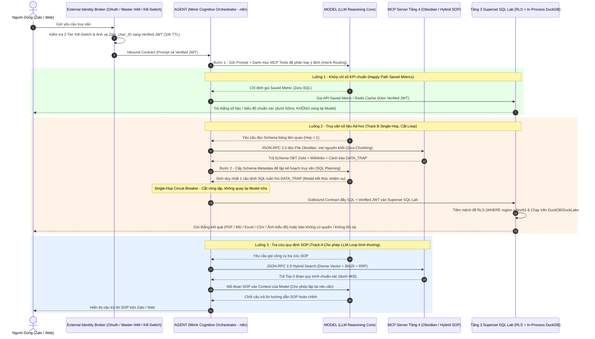

# ADR 0002: Bác Bỏ LangChain/LangGraph — Chuẩn Hóa Kiến Trúc Model – Agent – MCP & Cầu Dao Single-Hop

> **Architecture Decision Record (ADR)**  
> **Trạng thái:** Design / Proposed  
> **Ngày quyết định:** 2026-10-29  
> **Phạm vi kỹ thuật:** Tầng 5 (AI Gateway & Orchestration Layer) — Hệ sinh thái Yggdrasil Data Platform  

---

## 1. Context (Bối Cảnh)

Khi xây dựng **Tầng 5 (Mimir Cognitive Gateway)** để kết nối mô hình ngôn ngữ lớn (**Model**) với kho tri thức Tầng 4 (Obsidian Graph & Hybrid Vector DB) và tầng thực thi dữ liệu Tầng 3 (Apache Superset SQL Lab trên nền **Embedded In-Process DuckDB / DuckLake**), hầu hết các đội phát triển thường chọn **LangChain** hoặc **LangGraph** theo quán tính thị trường.

Tuy nhiên, qua thực tế kiểm chứng trên dữ liệu doanh nghiệp, việc đưa LangChain/LangGraph vào hệ thống gây ra 4 tử huyệt vận hành:
1. **15 Tầng Abstraction Rò Rỉ (Leaky Abstractions):** Một luồng gọi API tới Model và truyền nhận công cụ đơn giản bị bọc trong hàng chục lớp đối tượng chồng chéo (`RunnableBinding`, `AgentExecutor`, `StateGraph`...), khiến việc truy vết lỗi (Root Cause Analysis) và kiểm soát gói tin trở thành ác mộng.
2. **Biến Thái Prompt Ngầm Định (Opaque Prompt Mutations):** Framework tự ý nhồi thêm các đoạn hướng dẫn định dạng rườm rà vào System Prompt, đẩy **Prompt Entropy** tăng vọt và gây ra hiện tượng **Attention Collapse** — khiến Model phớt lờ các quy tắc nghiệp vụ và các khối cảnh báo `> [!WARNING] DATA_TRAP` trong Obsidian.
3. **Vòng Lặp Tự Hành Mất Kiểm Soát (Runaway ReAct Loops):** Trên nhánh phân tích dữ liệu (Text-to-SQL), khi câu lệnh SQL bị lỗi cú pháp hoặc trả về 0 dòng, Agent của LangGraph có xu hướng tự động lặp 5–10 vòng để thử sửa câu lệnh SQL. Hành vi này không chỉ đốt cháy ngân sách token theo cấp số nhân và kéo độ trễ lên `> 30s`, mà còn tiềm ẩn nguy cơ Model tự ý bỏ điều kiện lọc an toàn (như `WHERE is_deleted = false`) để ép ra số liệu sai sự thật.
4. **Sập Bộ Nhớ V8 Heap (Node.js OOM Crash):** Khi Agent tự do kéo các bảng dữ liệu lớn (như file xuất 50MB / hàng trăm ngàn dòng) nạp vào đối tượng trạng thái của runtime Node.js/n8n (vốn bị giới hạn cứng `1.4GB – 2GB` RAM), tiến trình điều phối lập tức sập vì lỗi `JavaScript heap out of memory`.

---

## 2. Decision (Quyết Định)

Chúng tôi quyết định **loại bỏ 100% LangChain và LangGraph**, bóc tách rõ bản chất **`Agent = LLM Loop`** và chuẩn hóa Tầng 5 của **Mimir** theo kiến trúc phân tách 3 vai trò **Model — Agent — MCP Server**:

### 2.1 Giải Ngố Khái Niệm "Agent": Bản Chất Chỉ Là Một Vòng Lặp LLM (`LLM Loop`)
Bất chấp những mỹ từ phức tạp hóa trên thị trường, một **AI Agent (hay ReAct Agent)** hoàn toàn không phải là một mô hình AI đặc biệt. Nó đơn giản chỉ là **một vòng lặp điều khiển (`LLM Loop`) bọc bên ngoài một Model không trạng thái (Stateless LLM)**:

$$\text{Agent} = \text{Loop}\Big(\text{Model}(\text{Context}, \text{Tools}) \xrightarrow{\text{tool call}} \text{MCP Tool} \xrightarrow{\text{append result}} \text{Model}\Big)$$

* Nếu **Model** yêu cầu gọi công cụ (`tool_calls`) $\to$ **Agent** gọi công cụ đó qua **MCP Server**, nối kết quả trả về vào ngữ cảnh rồi quay lại gọi **Model**.
* Nếu **Model** chốt câu trả lời (`stop`) $\to$ **Agent** thoát vòng lặp và trả kết quả ra ngoài.
* Chính vì bản chất của Agent chỉ là vòng lặp này, việc dùng một framework bên thứ ba bọc chồng chéo ("wrapper của wrapper") nặng 15 tầng abstraction như LangChain là hoàn toàn vô nghĩa; Mimir biểu diễn trực tiếp luồng điều phối này trên **n8n State Machine** (hoặc nếu viết bằng Python thì dùng trực tiếp **bộ SDK chính hãng của các nhà phát triển Model: `claude-agent-sdk` của Anthropic, `openai-agents` của OpenAI, hoặc `google-genai` của Google** — vốn đã hỗ trợ sẵn `LLM Loop` / automatic function calling, quản lý phiên, giới hạn bước lặp và cắm thẳng vào **MCP Server** mà không cần tự code vòng lặp hay `requests` thủ công).

### 2.2 Kiểm Soát Vòng Lặp Phân Hóa Theo Hai Luồng (Dual-Track Loop Control)
Thay vì đánh đồng mọi tác vụ vào một kiểu vòng lặp, Mimir điều khiển `LLM Loop` khác biệt hoàn toàn giữa luồng hỏi quy trình SOP và luồng gọi dữ liệu SQL:

1. **Với Luồng Hỏi Quy Trình / Văn Bản SOP (Track A — Luồng 3) $\implies$ Cho Phép Loop Bình Thường (Multi-Hop Loop):**
   * Khi tra cứu quy định nội bộ hay sổ tay SOP (`Hybrid Search: Dense + BM25`), mỗi lần gọi MCP Tool chỉ trả về vài đoạn văn bản rất nhẹ (`< 4KB`), không gây áp lực lên bộ nhớ V8 Heap và không có rủi ro làm sai lệch số liệu kế toán.
   * Do đó, trên luồng SOP, **Agent cứ việc lặp (`loop`) bình thường** qua nhiều bước nếu cần đối chiếu chéo nhiều văn bản quy trình trước khi tổng hợp câu trả lời.
2. **Với Luồng Gọi Dữ Liệu / Text-to-SQL (Track B — Luồng 2) $\implies$ Cắt Đứt Loop (`Single-Hop`) & Gửi Thẳng Kết Quả Cho User (Không Vòng Qua Model):**
   * Riêng với luồng truy xuất dữ liệu cấu trúc, Mimir **cắt sạch vòng lặp**: **Model** chỉ làm đúng 1 nhịp đọc Schema Obsidian và sinh 1 câu lệnh SQL.
   * Sau khi câu lệnh SQL được đẩy qua **Superset RLS (In-Process DuckDB)**, **kết quả thực thi được xuất thẳng về cho người dùng cuối dưới dạng file `PDF`, `Markdown (.md)`, `Excel`, `CSV` hoặc `Ảnh biểu đồ` mà tuyệt đối không quay ngược lại qua Model nữa**. Nếu kết quả rỗng (0 dòng hoặc bị RLS chặn), hệ thống báo thẳng cho người dùng: ***"Bạn không có quyền truy cập hoặc dữ liệu không tồn tại"***.
3. **Đóng Đinh Tác Vụ Nặng Ở Tầng Thực Thi Cấp Thấp:** Các tác vụ xử lý dữ liệu nặng (quét hàng triệu dòng Parquet, kiểm định 50MB Excel) nằm cố định ở **Golang (`Bifrost Proxy`), Polars/DuckDB (`Valkyrie`), và In-Process `DuckDB` bên dưới `Superset SQL Lab`**.

---

## 3. Sơ Đồ Luồng Hệ Thống Chuẩn Giữa Model – Agent – MCP Server

---

## 4. Consequences (Hệ Quả)

* **Kiểm soát 100% System Prompt & Prompt Entropy:** Loại bỏ hoàn toàn hiện tượng framework tự ý sửa đổi Prompt, đảm bảo **Model** tuân thủ tuyệt đối các khối cảnh báo `> [!WARNING] DATA_TRAP` trong Obsidian.
* **An toàn tuyệt đối cho bộ nhớ V8 Heap & Chi phí Token:** Nhờ sự phân vai rõ ràng giữa **Model** (suy luận) và **Agent** (cưỡng chế **Single-Hop Circuit Breaker** trên luồng Data và xuất thẳng kết quả `PDF / MD / Excel / CSV / Ảnh biểu đồ` về cho User mà không vòng ngược lại qua Model), hệ thống điều phối trên n8n không bao giờ bị tràn RAM hay rơi vào vòng lặp tự sửa SQL vô tận.
* **Minh bạch và Dễ kiểm toán (100% Auditable):** Toàn bộ luồng giao tiếp giữa Agent, Model và MCP Server đều đi qua các bước trạng thái tường minh trên n8n và gói tin chuẩn JSON-RPC 2.0, cho phép đội ngũ kỹ thuật định vị bất kỳ lỗi nào trong vài giây.
